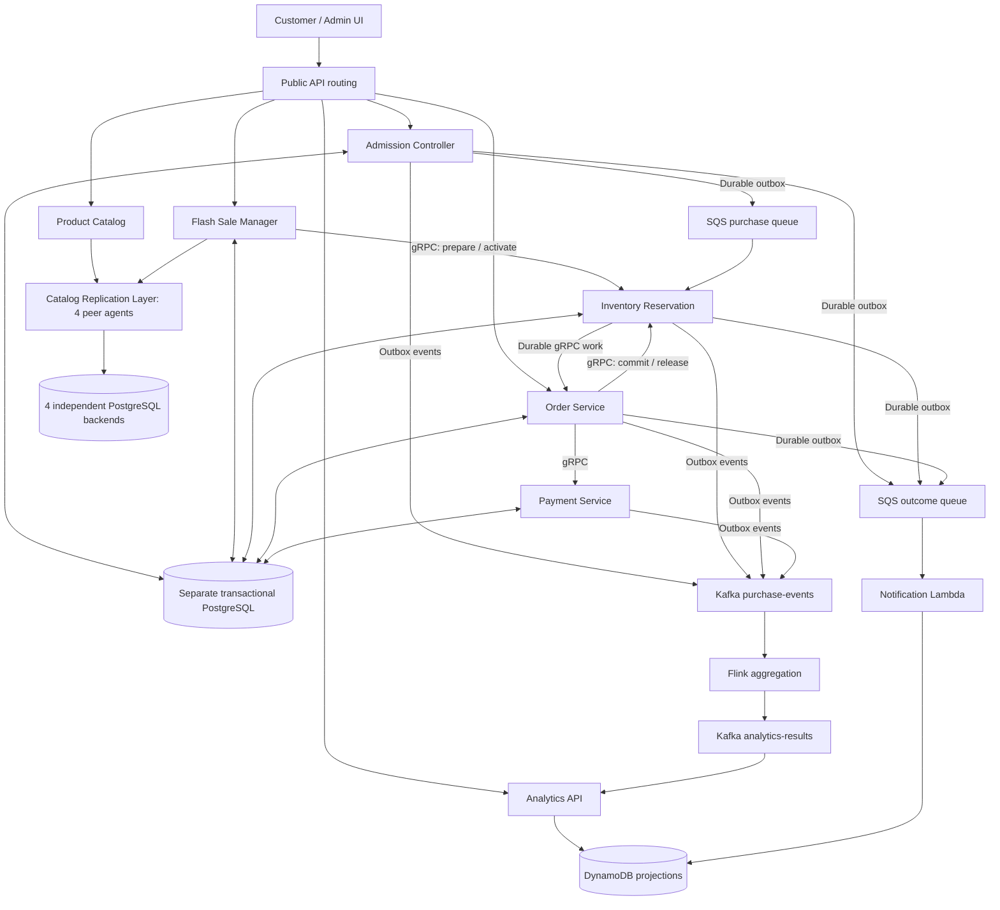

# Flashkart: Technical Implementation Plan

## 1. Architecture and fixed scope

Build eight application microservices, a Go Catalog Replication Layer backed by standard PostgreSQL databases, and a small React/TypeScript frontend. Use Go for application services and replication middleware, and Java 17 for Flink.

The replication component is domain-specific middleware. PostgreSQL supplies each replica's storage engine, transactions, indexes, write-ahead logging, and crash recovery. Our Go code implements replication and coordination between independent databases. We do not implement a database engine, SQL parser, query optimizer, or arbitrary SQL replication.

### Consistency and ownership

- **Catalog Replication Layer:** product documents and immutable published-sale documents, replicated across four independent PostgreSQL instances.
- **Transactional PostgreSQL:** authoritative sale execution rules, admission attempts, stock, reservations, orders, and simulated payments. This is a separate fifth PostgreSQL instance.
- **DynamoDB:** notification and analytics projections.
- **S3:** frontend assets, product images, and analytics checkpoints/recovery metadata.

Each of the four replica databases belongs to one logical Go replica agent. Agents access their own database and communicate with peers over gRPC. No PostgreSQL streaming or logical replication, RDS read-replica relationship, shared write endpoint, or cross-database transaction connects these four backends. There is no permanent coordinator or elected leader in our replication layer.

| Application service | Responsibilities and interfaces | Deployment and persistence |
| --- | --- | --- |
| Product Catalog | Product browsing and administration; published-sale details; conflict-resolution UI support | Go on EKS; Catalog Replication Layer |
| Flash Sale Manager | Editable drafts and durable, retryable sale publication | Go on EKS; transactional PostgreSQL and Catalog Replication Layer |
| Admission Controller | Rate limiting, idempotency, purchase acceptance, attempt-status API | Go on EKS; transactional PostgreSQL and SQS; reads terminal-outcome projections |
| Inventory Reservation | Atomic reservation, confirmation, release, and expiry | Go on EKS; transactional PostgreSQL |
| Order | Durable purchase orchestration and order queries | Go on EKS; transactional PostgreSQL |
| Payment | Deterministic payment simulation, status lookup, and compensation | Go on EKS; transactional PostgreSQL |
| Notification | Consume terminal outcomes and persist in-app notifications | Go Lambda; SQS and DynamoDB |
| Sales Analytics | Windowed aggregation and result projection/query API | Java Flink on EMR/EKS; Go companion; Kafka and DynamoDB |

The Flink job and analytics companion constitute one logical service. The four replica agents are supporting infrastructure, not replacements for any of the eight application services.

The replication box groups four peers; it is not a central gateway. A request can enter through any healthy agent, which coordinates that request and uses peer RPCs to reach the other replicas.

### Product defaults

- One unit per attempt; distinct attempts may purchase additional units.
- Published sale product, price, stock limit, and time window are immutable. Drafts remain editable.
- Money uses integer minor units; timestamps use UTC.
- Demo customer identities and protected admin access; no registration or real payment processing.
- Notifications appear in the application.
- Frontend screens cover customer purchases, sale administration, analytics, and replica/conflict inspection.
- Planning and milestones are technical; no team-size or deadline assumptions are required.

## 2. Core technical behavior

### PostgreSQL-backed Catalog Replication Layer

Run four identical Go agents with fixed logical identities A, B, C, and D. Each owns a different standalone PostgreSQL instance. Keep fixed membership, a consistent-hash ring with virtual nodes, replication factor **N=3**, read threshold **R=2**, and write threshold **W=2**. Replica selection always chooses distinct physical backends.

For each document, the ring identifies three permanent owners and the remaining node as fallback. Membership and ownership do not change merely because a node is unreachable. HPA does not change the replica count or ring.

**Persistence boundary.** Use ordinary PostgreSQL tables for document versions, pending hints, per-document counters, and prepared mutation records. Documents and causal metadata use JSONB; identity, operation, and hint-target fields use indexed columns and uniqueness constraints. Each database uses the same migrations. The application data contract supports only product and published-sale documents.

Inside one replica, serialize version merges and counter allocation by locking that document's metadata row with `SELECT ... FOR UPDATE` in the local SQL transaction. Each acknowledgement follows a successful local SQL commit. Keep peer network calls outside SQL transactions. A database connection failure, rollback, or ambiguous commit cannot count as a successful acknowledgement; retry/query the same operation to establish its outcome.

**Writes.** The coordinating agent sends a version to its three preferred owners concurrently. Missing acknowledgements trigger fallback storage. The fallback commits the complete version and its intended-owner hints atomically. Two distinct physical replicas must acknowledge before the operation succeeds; one fallback holding hints for two owners contributes only one acknowledgement. Continue attempts to reach remaining owners after replying, with background recovery covering coordinator failure.

**Reads.** Contact all four agents, including fallback-held versions, and collect responses until completion or the deadline. Require at least two successful database-backed responses and reconcile all received versions. A successful database read with no matching record is an empty response; an unavailable database is not. Read repair updates reachable owners.

Use configurable defaults of 250 ms per peer and a one-second overall request deadline. A write that does not reach its threshold returns an unknown outcome because partial commits may remain. The system does not roll back successful local writes across other replicas.

**Version tracking and conflicts.** Use dotted versions with exact causal contexts, represented as per-node counter intervals that retain gaps. Store counters and newly prepared envelopes durably in PostgreSQL. A larger counter alone does not prove that a writer observed an earlier version. Updates carry the caller's observed context rather than silently incorporating other versions known by the coordinator.

Reads return all causally maximal siblings and their combined context. Explicit conflict resolution writes a replacement using the context of the observed siblings. Concurrent mutable product versions cause `409 CATALOG_CONFLICT` and appear in the admin screen. Do not resolve prices using wall-clock last-write-wins. Preserve identical-envelope idempotency through every replication and repair path.

**Recovery.** Retry durable hinted handoff every second. Each hint retains the complete immutable mutation envelope and intended owner, independently of pruning superseded visible document versions. The destination merges the version in a local SQL transaction and acknowledges only after commit, or after confirming a durable causal successor. Delete the corresponding source hint only after that acknowledgement; a crash between these steps causes safe duplicate delivery. Hints do not expire. Run paginated background synchronization over visible versions and outstanding hints every ten seconds so untouched keys also recover. Use the same causal merge for writes, reads, repair, handoff, and synchronization.

**Retryable publication.** `PrepareMutation` journals an immutable envelope in the originating replica database without making the document visible. The publication workflow records the operation ID and origin in transactional PostgreSQL, then persists the returned envelope before calling `ApplyMutation`. Application of that envelope can be retried through any agent. A lost preparation response is retried at the recorded origin; it must not silently allocate a different version elsewhere. This is local preparation for idempotent retries, not distributed two-phase commit.

**Guarantees and limits.** Sloppy quorums provide eventual consistency. `R + W > N` does not ensure overlapping respondents when fallback replicas participate. Partitions can produce stale reads, temporary not-found results, and concurrent histories. With two reachable logical replicas, quorum operations can proceed, subject to the preparation-retry affinity above. Three unavailable replicas prevent R=2/W=2. Recovery assumes durable backend data survives; permanent loss of all copies cannot be repaired.

Dynamic membership, gossip, Merkle trees, deletion/tombstone collection, arbitrary SQL execution, general-purpose query APIs, and cross-replica ACID transactions are outside this version.

### Purchase workflow and correctness

Use service-owned schemas and roles in the separate transactional PostgreSQL instance. Application services communicate through APIs or messages and do not modify another service's tables. This database does not participate in the catalog's quorum protocol.

1. **Publish a sale:** durably record the workflow, prepare Inventory's immutable configuration, publish the document through the replication layer, then activate Inventory. Interrupted publication remains pending and resumes idempotently. Purchases require activation.
2. **Accept an attempt:** Admission applies a per-replica token bucket and bounded concurrency. A SQL transaction persists the attempt and purchase-queue outbox entry. Return `202` only after commit.
3. **Reserve stock:** Inventory consumes SQS and atomically records the attempt outcome, conditionally decrements available stock, creates the reservation, and records outgoing work.
4. **Process the order:** durable Inventory work calls Order over gRPC. Order persists its workflow before acknowledging and calls Payment with a stable payment ID.
5. **Finalize:** payment success requires a successful Inventory commit before Order becomes confirmed. Payment failure releases the reservation.
6. **Publish outcomes:** transactional outboxes independently deliver business events and terminal notifications.

Required rules:

- `attempt_id` identifies one purchase intent end to end; reuse with different input returns `409`.
- Persist unsuccessful reservation outcomes too, so retries cannot turn the same rejected attempt into a later purchase.
- Reservation transitions are `HELD -> COMMITTED`, `HELD -> RELEASED`, or `HELD -> EXPIRED`.
- Default reservation lifetime is two minutes, with a five-second expiry sweep; both are configurable.
- Confirmation and expiry serialize on the reservation row and check database time after acquiring the lock.
- A payment timeout means unknown status; query/retry the same payment rather than charging again.
- Payment success after expiry requires an idempotent simulated refund and order cancellation.
- Delete queue messages only after durable processing or durable transfer into the next workflow.

Maintain **available + held + sold = initial stock**. Queue and outbox delivery are at least once; every business effect is idempotent. Catalog data never supplies the authoritative stock count or overrides Inventory's sale terms.

### Analytics and notifications

Use a versioned JSON event envelope with `event_id`, `event_type`, `occurred_at`, `sale_id`, relevant entity IDs, `trace_id`, and payload.

- Publish business events to `purchase-events`, keyed by sale ID.
- Flink deduplicates stable event IDs and computes one-minute event-time windows.
- Allow ten seconds of out-of-order arrival and thirty seconds of lateness; count events dropped beyond the lateness boundary.
- Produce final window snapshots of demand, admission rejections, stock rejections, reservations, confirmed purchases, and processing latency.
- The analytics companion emits partition heartbeats so idle traffic does not indefinitely prevent window completion. Heartbeats do not contribute to business aggregates.
- Enable checkpoints and an at-least-once Kafka sink to `analytics-results`.
- Project complete results into DynamoDB using conditional upserts keyed by sale/window; duplicate results do not increment totals.
- Notification Lambda conditionally writes terminal outcomes keyed by customer/attempt. Duplicate or delayed messages cannot regress a terminal outcome.

Do not claim end-to-end exactly-once delivery. Database-backed catalog replication does not change this analytics design.

## 3. Contracts and implementation structure

Use a monorepo with one Go module, one Maven analytics module, one frontend package, infrastructure, GitOps configuration, and tests. Share contracts and infrastructure helpers while keeping service business logic separate.

### Public REST contracts

- Product and published-sale list/detail endpoints.
- Admin product updates and explicit conflict resolution.
- Sale draft creation/update, publish action, and publication-status lookup.
- `POST /api/attempts` with an idempotency key.
- Attempt status, order detail, notification list, and analytics queries.
- Admin-only replica diagnostics and conflict inspection.

Attempt responses distinguish queued, rejected, confirmed, and cancelled outcomes. `202` means accepted for processing, never purchased. Product-list discovery is eventually consistent; it is not a cross-replica transactional snapshot.

### Internal contracts

- Inventory gRPC: prepare/activate sale, commit/release reservation, inspect reservation.
- Order gRPC: idempotently create an order from a reservation.
- Payment gRPC: simulate/query payment and refund.
- Replication client API: read product/published-sale documents, prepare/apply document mutations, and list document IDs for catalog discovery.
- Replica peer gRPC: read versions, merge versions, deliver hints, and exchange paginated synchronization data.

The replication API is not a SQL proxy. Public callers cannot choose tables, execute SQL, connect directly to replica databases, or bypass causal conflict handling. A shared Go client handles coordinator selection, deadlines, and document-version envelopes.

Define OpenAPI, protobufs, and event JSON schemas before implementation. Include deadlines, correlation IDs, structured errors, and compatibility checks.

Use Go `net/http`, `pgx`, explicit SQL migrations, `grpc-go`, AWS SDK for Go v2, and `franz-go`. Both transactional persistence and replica-local persistence use PostgreSQL adapters, with different database credentials and ownership. There is no bbolt or other custom embedded persistence dependency in the replication layer. Payment fixtures cover success, decline, delayed success, and lost responses.

## 4. Local development and AWS deployment

### Local environments

1. **Development:** Go processes plus five standalone PostgreSQL containers, Kafka, Flink, and AWS Emulator. Four PostgreSQL containers back the replica agents; the fifth serves transactional application schemas. Each database has its own durable volume.
2. **Deployment rehearsal:** kind Kubernetes with ArgoCD, standard PostgreSQL instances with separate volumes, the same application manifests, Flink operator, Metrics Server, Prometheus, Grafana, and centralized local logs.

Use the same application code, SQL migrations, and message contracts in both environments. Change endpoints, credentials, and deployment configuration. Real local PostgreSQL instances exercise data persistence; emulated RDS control-plane responses are not a substitute for database engines.

Verify AWS Emulator coverage for the SQS, DynamoDB, S3, and Lambda operations used by the implementation. If Lambda event-source behavior is unverified, run the same notification handler through a local SQS runner. IAM, EKS, RDS networking, and EMR/MSK integration remain cloud tests. Installed-emulator compatibility has not yet been verified.

### Replica deployment

- Four named, single-replica Go Deployments with stable Services and identities A-D; each points to one dedicated PostgreSQL backend.
- Use replacement deployment semantics for each logical agent and spread agents across workers. Keep replica membership fixed rather than autoscaling these Deployments.
- Persist all documents, hints, counters, and prepared mutations in the assigned database. Agent containers require no persistent disk, PVC, or dedicated EBS volume.
- A restarted agent reconnects to its existing database and resumes recovery work. A database outage makes that logical replica unavailable even if its agent process is still running.
- Readiness checks require database connectivity and the expected migration version. Agent liveness is separate from database health so an RDS outage does not cause an unnecessary restart loop.
- Each replica has its own credentials and SQL permissions. A coordinating agent reaches another backend only through that backend's agent.

### AWS baseline

- Region: `ap-south-1`; EKS managed EC2 workers across two availability zones.
- Four independent, standalone Single-AZ RDS PostgreSQL instances for catalog replicas, distributed across the two zones, plus one separate transactional RDS PostgreSQL instance. No inter-instance PostgreSQL replication is enabled. Instance independence does not imply availability-zone independence.
- DynamoDB on-demand tables, S3, SQS queues with dead-letter queues, and Go Notification Lambda.
- MSK Serverless with private networking and IAM authentication. Go uses AWS's IAM signer; Java uses the MSK IAM authentication library.
- EMR on EKS 7.13.0, Java 17, Flink 1.20, and Kafka connector `3.4.0-1.20`; checkpoint and recovery metadata go to S3.
- React assets in private S3 behind CloudFront's default HTTPS hostname. API requests use a CloudFront VPC origin and internal ALB.
- Prometheus/Grafana for metrics; Fluent Bit and CloudWatch for application, replica-agent, and Flink logs. Lambda logs also go to CloudWatch.

Terraform owns cloud resources, including the five RDS instances, networking, IAM, ALB target groups, and initial ArgoCD installation. ArgoCD owns subsequent Kubernetes resources, including replica-agent Deployments, TargetGroupBindings, operators, migration Jobs, and application updates. Schema migrations are explicit versioned application operations. There are no replica-agent data volumes to provision in AWS.

Configure Catalog and Admission HPAs with two to five replicas and a 60% CPU target. Set resource requests and provide capacity for both maximum replica counts and the four fixed replica agents. Database connections use bounded pools.

CI tests and builds immutable images, then updates GitOps image references. ArgoCD deploys services; direct `kubectl apply` is not used for application deployment.

Observability includes RPS, errors, latency, Kubernetes health, stock invariants, queue/outbox backlog, replication quorum failures, sibling counts, pending-hint count/age, synchronization progress, and each replica's SQL connectivity/commit failures. Teardown removes applications while their controllers are available, then disposable infrastructure; preserve bootstrap state and build artifacts separately so clean redeployment remains reproducible.

## 5. Implementation sequence and acceptance criteria

The [phased implementation plan](phased-implementation-plan.md) expands these stages into twelve phases with dependencies, concrete deliverables, and completion checks. Use that roadmap to sequence implementation; the architecture and acceptance requirements here remain authoritative.

Implement in dependency order:

1. **Foundation:** contracts, repository structure, five local PostgreSQL backends, migrations, dependency bootstrap, health endpoints, structured logging, and metrics.
2. **Replication middleware:** SQL-backed local operations and operation journals; fixed peer identity; placement; causal tracking; quorum writes/reads; fallback writes; hints; repair; synchronization; fault tests.
3. **Catalog and publication:** integrate document reads and writes into Product Catalog and the durable sale-publication workflow. Add conflict and replica diagnostics.
4. **Purchase workflow:** Admission, Inventory, Order, Payment, queues, outboxes, expiry, and compensation.
5. **Outcomes and analytics:** Notification Lambda, Kafka events, Flink windows, result projection, and frontend.
6. **Deployment rehearsal:** kind, ArgoCD, monitoring, HPA, independent database/agent outages, and recovery exercises.
7. **AWS verification:** managed-service integration, public access, actual RDS connectivity failures, recovery, teardown, and clean redeployment.

### Acceptance scenarios

| Area | Required evidence |
| --- | --- |
| Stock | 1,000 concurrent attempts against 100 units never violate `available + held + sold = initial stock`. |
| Business idempotency | Duplicate HTTP requests, SQS deliveries, RPC calls, and outbox publication produce one business effect. |
| Workflow recovery | Crashes after reservation, payment, publication, and event commits resume without lost work. |
| Expiry | Confirmation/expiry races have one winner; late successful payments are compensated. |
| Persistence ownership | Inspection shows separate records in independent PostgreSQL backends, with PostgreSQL/RDS native replication disabled between them. |
| Agent failure | Stopping or replacing one agent preserves its SQL data; surviving peers continue and the replacement resumes repair. |
| Database failure | Making one backend unreachable causes quorum/fallback behavior even when its Go agent is alive. SQL failures never count as acknowledgements. |
| Local transaction safety | Concurrent merges for the same document preserve siblings; rollback and lost-commit-response cases do not create false acknowledgements or duplicate effects. |
| Hinted durability | After two preferred owners fail, a surviving owner plus fallback can satisfy W=2. Two hints on one fallback still count as one acknowledgement. Hints survive both agent and backend restarts. |
| Handoff recovery | Crashes before/after destination commit and before/after source hint deletion cause safe retries and no lost acknowledged versions. |
| Partitions | A 2-2 peer partition demonstrates independent writes, stale reads, preserved siblings, and convergence after resolution. Each side uses only its own available backends. |
| Causality | Stale writes through the same coordinator remain concurrent; counter gaps never imply observation. |
| Background recovery | Untouched documents converge after recovery without requiring a client read. |
| Quorum loss | With three logical replicas unavailable, reads and writes fail explicitly rather than claiming success. |
| Analytics | Duplicate/delayed events, checkpoint recovery, and projection restarts produce correct window snapshots. |
| Kubernetes | Sustained k6 traffic scales both HPAs; GitOps restores altered application configuration. |
| Cloud integration | IAM, MSK token refresh, Lambda-SQS invocation, RDS connectivity, S3 checkpoint recovery, centralized logs, and clean redeployment pass. |

Completion means these behaviors are reproducible through scripts, tests, dashboards, and the demo UI. A database-backed replica failure and a replica-agent failure are distinct demonstrations and must both be covered.

## Technical references

- [Original Dynamo design](https://www.allthingsdistributed.com/files/amazon-dynamo-sosp2007.pdf): leaderless coordination, versioning, quorum-like operations, and recovery mechanisms.
- [Dotted version tracking](https://gsd.di.uminho.pt/members/vff/dotted-version-vectors-2012.pdf): motivation for representing causality independently of simple counter ordering.
- [PostgreSQL schemas and databases](https://www.postgresql.org/docs/current/ddl-schemas.html): logical namespaces are not independent database-server failure domains.
- [RDS read replicas](https://docs.aws.amazon.com/AmazonRDS/latest/UserGuide/USER_ReadRepl.html): native primary/read-only replication, which is not used between our catalog backends.
- [Transactional outbox](https://docs.aws.amazon.com/prescriptive-guidance/latest/cloud-design-patterns/transactional-outbox.html): reliable publication of committed business changes.
- [MSK Serverless](https://docs.aws.amazon.com/msk/latest/developerguide/serverless.html) and [IAM client configuration](https://docs.aws.amazon.com/msk/latest/developerguide/configure-clients-for-iam-access-control.html).
- [EMR on EKS Flink release](https://docs.aws.amazon.com/emr/latest/EMR-on-EKS-DevelopmentGuide/emr-eks-7.13.0-flink-20260410.html), [Kafka connector compatibility](https://flink.apache.org/downloads/#apache-flink-kafka-connector-340), and [Flink Kafka delivery guarantees](https://nightlies.apache.org/flink/flink-docs-release-1.20/docs/connectors/datastream/kafka/).
- [AWS Emulator verification guidance](https://docs.aws.amazon.com/emulator/latest/userguide/check-project.html).
