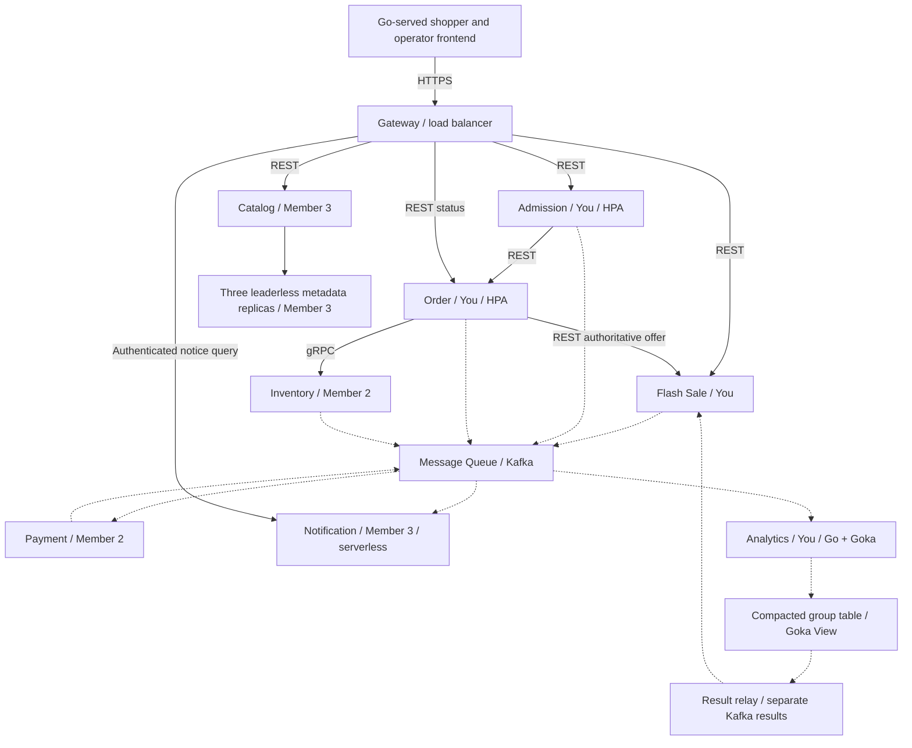

# Implementation Plan: Flash Sale Platform

**Branch**: `001-lead-implementation`
| **Date**: 2026-10-25 | **Spec**: [spec.md](spec.md)

**Input**: Feature specification from `specs/001-flash-sale-platform/spec.md`

## Summary

Plan the eight-service project with concrete technology choices only for the project lead's
Admission, Flash Sale Manager, Order, Sales Analytics, frontend, gateway and Message Queue work.
Your stack is Go, Goka and Sarama with PostgreSQL for your transactional state. Other owners retain
control of their languages, frameworks, database engines and deployment tools. Shared contracts
preserve stock correctness, asynchronous payment, notifications, analytics and leaderless metadata.
[Research](research.md), [data model](data-model.md), [contracts](contracts/README.md) and
[validation guide](quickstart.md) complete Phase 1. No implementation or deployment is performed.

## Technical Context

**Language/Version**: Your components use Go 1.27.3. Analytics uses Goka v1.1.17 with IBM Sarama
v1.46.3; your other Kafka clients use the same Sarama version. Your frontend uses Go html/template
and small plain JavaScript modules served by the gateway. Python 3.11+ remains workflow/contract
tooling only. No teammate language or frontend/backend framework is prescribed for their services.

**Primary Dependencies**: For your code: standard net/http, html/template and slog; pgx v5;
grpc-go/protobuf for the Inventory client; a JWT validation library; Sarama; Goka processor/View
and its local cache. Share only generated contracts and small transport/auth/telemetry helpers;
business rules and saga state stay with their owners. Pin all versions/digests in implementation.

**Storage**: Your Flash Sale, Admission and Order each own PostgreSQL 17 databases/credentials.
Admission uses SQL quota rows and expiring leases. Analytics state is authoritative in Kafka's
compacted Goka group table, with rebuildable local caches and a durable-state result relay.
Raw retention is seven days; dedup/finalization retention is at least eight days. Inventory,
Payment, Catalog, Notification and custom-replica engine choices belong to their respective owners;
the shared data model defines guarantees, not their physical schemas or database versions.

**Testing**: For your code: Go testing, `_test.go`, `go test -race`, gofmt, go vet, staticcheck,
Goka tester plus real Kafka crash/rebalance/rebuild tests, Testcontainers-Go PostgreSQL/Kafka,
HTTP/DOM/browser journey checks and k6 load scenarios. Contract validation parses OpenAPI 3.1,
compiles Inventory protobuf and validates JSON Schema events/examples. Teammates choose their
own unit-test frameworks and supply adapter/test commands for shared acceptance checks.

**Target Platform**: Your Linux containers run on the agreed managed Kubernetes platform; local
Docker Compose provides your PostgreSQL and Kafka KRaft dependencies. Goka Analytics joins the
original six ordinary services as the seventh Kubernetes domain workload; Notifications remains
event-triggered serverless. Provider, IaC/GitOps products, function platform and teammate runtimes
are delegated to the platform/service owners. Kafka broker provisioning is your responsibility in
coordination with the platform owner; Sarama is its client library, not a replacement broker.

**Project Type**: Monorepo distributed web application and cloud/distributed-storage demonstration.

**Performance Goals**: Preserve SC-001-SC-015: 100-unit correctness sale; >=10,000 attempts over ten
minutes from >=50 shoppers; p95 browse/purchase <=2s, overload rejection <=1s; normal settlement
and notice <=10s at p95; unpaid holds reclaimed <=10s after 120s expiry; refund <=30s after recovery;
work resumes <=60s; finalized summary visible <=5s after lateness cutoff; replica convergence
<=60s for 100 products. Unexpected errors <1%. These are unmeasured acceptance targets.

**Constraints**: REST public/Admission-to-Order, gRPC Order-to-Inventory, Kafka raw/results separation,
serverless Notification, IaC, GitOps, resource-based Admission/Order HPA, Prometheus/Grafana,
centralized logs, public HTTPS and private internal operations. Three storage-product categories
remain required. The user's Goka choice explicitly supersedes the source's earlier Flink/managed
stream-runtime prescription. This does not change purchase or analytics business outcomes.

**Scale/Scope**: Eight domain services; three members with 4+2+2 ownership; three fixed leaderless
metadata replicas (N=3/R=2/W=2); six analytics partitions; one-product orders, quantity 1..100;
seven user stories. No cart, real payments, fulfillment, dynamic store membership or multi-region.

### Architecture and boundaries



Your gateway is a route/auth/template adapter with no saga or business-data credentials. Flash
Sale owns authoritative offers and its operator analytics projection. Admission owns shared quotas.
Order owns durable purchase intents and saga progress. Inventory alone decides stock transitions;
Payment records stable charge/refund outcomes; Notification deduplicates notices; Catalog owns its
metadata client and offers projection. Goka processor, View and results relay are one Analytics
responsibility; they do not add another domain service.

Each state owner uses its own credentials. Business changes and follow-up events commit together;
consumers persist inbox dedup before acknowledging. Kafka destination receipts keep domain and
analytics copies durable with the same event ID. No cross-topic ordering is assumed. Inventory's
locked authoritative time decides expiry; an ambiguous successful Confirm is queried before
Order confirms or compensates. [data-model.md](data-model.md) contains all transition/recovery rules.

### Your analytics design

Use Goka's persisted group table keyed by sale/product/minute window. The input and table topics
have six partitions and the same hash; producer partitioners and recovery tests enforce that
mapping. Choose windows from occurrence time, and use broker LogAppendTime as stable arrival time.
Your clock emitter queries Flash Sale's schedule endpoint and appends per-window heartbeat records
once per second. The same ordered input partition therefore carries data and finalization markers,
including empty windows. At/after end+60s, new input for that window is late; a marker finalizes it.
A replay does not substitute the current wall clock for the original record's arrival/cutoff.

The processor persists counts, exact distinct/seen sets, revision/final flag and output identities;
it does not emit an uncommitted result. A Goka View sees durable state changes, and a retrying
Sarama relay publishes those stored results. On restart/rebalance it waits for recovery and queues
stored outputs again. Duplicate results have deterministic event IDs and the same revision;
Flash Sale replaces only newer revisions. Late output identities remain replayable in state too.
This is at-least-once delivery with repeat-safe business outcomes, not a claim of transactional
exactly-once Goka output. State/output/offset interruption tests are required.

Keep compact-only state topics, eight-day dedup/finalization data, bounded per-window state size,
startup cache rebuild and partition-reassignment evidence. Your one-second tick and relay cadence
leave three seconds for processing/projection within SC-009's five-second healthy-workload budget.
A lagging emitter, unrecovered View or Kafka outage marks results delayed instead of reporting
fresh zero sales. Avoid blind partition-count changes; rebuild/repartition with a reviewed migration.

### Team ownership and delegated choices

| Lead | Domain services | Supporting scope | Concrete stack choices in this plan |
| --- | --- | --- | --- |
| You | Admission, Flash Sale, Order, Analytics | Frontend, gateway, Message Queue; (c) HPA/load and (e) streaming | Go, Goka, Sarama, your PostgreSQL and validation tools |
| Member 2 | Inventory, Payment | Platform/IaC (a), GitOps (d), observability (h) | Chosen by Member 2; shared contracts/guarantees only |
| Member 3 | Catalog, Notification | Communications/serverless (b), leaderless concept (f), storage products (g) | Chosen by Member 3; shared contracts/guarantees only |

Members supply their preferred language, database/storage implementation, start/test adapters and
platform products in owner-maintained planning notes before their implementation. These are
explicitly delegated decisions and do not require choosing a stack on their behalf here. Create
`task_divison.txt` with actual names at implementation scaffolding; no application/task files are
created in this planning command. Required consumer reviews remain pre-implementation/merge gates.

### Platform integration contract

The platform owner supplies managed Kubernetes capacity, public HTTPS, private service networking,
secrets/service identities, persistent storage for the concept replicas and a serverless event/query
adapter for Notification. You supply container health/readiness endpoints, resource requests,
shutdown/draining behavior, broker configuration and dashboards/metrics for your components. All
infrastructure is versioned IaC; application updates reconcile through a tracked Git repository.
No direct manual service deployment replaces GitOps. No specific provider or paid product is chosen.

Admission and Order start with HPA min=1/max=6, CPU target 60%, requests 100m/128Mi, limits
1CPU/512Mi, scale-up stabilization 30s and scale-down 300s. Platform must supply resource metrics
and worker headroom. Measure real-path demand and tune versioned settings; do not add fake CPU work
to trigger scaling. Analytics starts with one processor; a second instance is used for rebalance
recovery tests, never more active processors than its six partitions.

Prometheus/Grafana show request rates, errors, latency, outbox/consumer lag, stock/refund state,
Goka recovery/view lag and replica health. Logs from all eight services are centralized, including
the serverless handler. Propagate correlation/event/order IDs; exclude secrets/tokens and
high-cardinality shopper metric labels. Rollback uses reviewed versioned revisions, compatible
schema evolution and retained business state; cache rebuild is not loss of authoritative data.
Three distinct product uses remain transactional state, object media/evidence, and independent
replica block storage. Provider/product selection and actual spend are the owners' deployment inputs.

### Delivery and validation

1. Review shared contracts with consumers; scaffold your Go workspace, fixtures and local commands.
2. Complete sale readiness and one purchase with teammate-supplied contract mocks/adapters.
3. Replace mocks with real Inventory/Payment/Notification; complete failure, expiry, compensation
   and every ambiguous-boundary recovery case.
4. Implement Goka aggregation, state-view relay and golden/replay tests; integrate Catalog's
   quorum/conflict/recovery through its language-neutral contract.
5. Integrate the owners' platform choices, then capture public access, rollback, HPA, logs/metrics,
   storage-product and individual demonstration evidence.

Mocks allow independent progress; only real cross-service runs pass final acceptance. Commands
below are future implementation deliverables; [quickstart.md](quickstart.md) identifies what can
run now and the expected end-to-end results. Go tests run per module rather than assuming
workspace-root `./...` covers every module. No teammate test framework is mandated.

| Planned command | Evidence |
| --- | --- |
| `make fmt-check lint typecheck contracts-check` | Your gofmt/vet/staticcheck/compiler; JSON/OpenAPI/protobuf; generated-client drift; teammate checks through supplied adapters |
| `make test-unit` | Your Go rules, Goka tester, clocks, validation and template/HTTP behavior |
| `make test-integration` | PostgreSQL/Kafka, outbox/inbox, Goka table/view relay, rebalance/rebuild and teammate interfaces |
| `make test-races` | Oversell, same-key concurrency, expiry/Confirm and lost-response recovery |
| `make test-e2e` | All seven stories through real service adapters and access checks |
| `make demo SCENARIO=...` | Deterministic scenario reports with IDs, outcomes and invariant evidence |
| `make load PROFILE=correctness` | 100-unit/10,000-attempt workload, timings and stock-transition ledger |
| `make load PROFILE=scaling` | Sustained real demand, both HPA increases, resource/limit evidence |

| Requirements / outcomes | Verification | Owner |
| --- | --- | --- |
| FR-001-FR-004; SC-001/014 | Sale readiness/version, boundaries, offer/role and own-record checks | You + Member 3 |
| FR-005-FR-010; SC-002/003/004 | Shared quotas, durable request identity, stock ledger, offer mismatch | You + Member 2 |
| FR-011-FR-017; SC-005/006/007 | Payment/refund stability, races, interrupted transitions, retry/quarantine | You + Member 2 |
| FR-018-FR-019; SC-008 | Canonical notices, failure/replay and independent progress | Member 3 |
| FR-020-FR-022; SC-009 | Event-time/broker cutoffs, golden totals, stable output, rebalance/cache rebuild | You |
| FR-023-FR-026; SC-010 | Quorums, conflicts, uncertain writes, durable recovery and repair | Member 3 |
| FR-027-FR-033; SC-011/012/013/015 | Platform access, IaC/GitOps/rollback, HPA, storage and all-service evidence | Member 2 + all |
| FR-034-FR-035 | Ownership, command documentation, quality gates and contracts review | All |

### Design validation performed

On 2026-10-25, all three OpenAPI 3.1 documents passed schema validation and local-reference checks.
The event schema passed all 22 type examples and 44 rejection controls; three HTTP request/response
example pairs validated. Inventory protobuf compiled with its four RPCs. Spec Kit prerequisites,
template hierarchy, local links, placeholders, whitespace and quickstart shell syntax passed.
Temporary validators and protobuf descriptor output were kept under `/tmp`; no application or
cloud command was executed. These checks validate design artifacts, not the planned runtime.

## Constitution Check

*GATE: Must pass before Phase 0 research. Re-check after Phase 1 design.*

| Gate | Before research | After Phase 1 | Evidence / required follow-through |
| --- | --- | --- | --- |
| I. Readable, Consistent Code | PASS | PASS | Lead-only Go stack, small shared helpers, explicit quality commands |
| II. Explicit Boundaries and Contracts | PASS | PASS | Owned state; REST/protobuf/replica/events; teammate stacks delegated |
| III. Behavior-Based Verification | PASS | PASS | FR/SC mapping, controlled clocks, real-adapter scenario guide |
| IV. Distributed Correctness Under Failure | PASS | PASS | Inventory races/saga recovery; Goka durable state/relay; concept repair |
| V. Maintainability and Operational Clarity | PASS | PASS | Owners, command contracts, health/logs/metrics and rollout/recovery |
| Latest user/source scope | PASS | PASS | Explicit Goka/Sarama amendment, Kafka retained, no teammate stack mandates |

These are design-compliance results, not completed runtime checks or teammate approvals. No
constitution exceptions are required. The latest user instructions authorize the recorded engine
and ownership-scope amendment. Owner-delegated technology choices and environment credentials are
handoff inputs; they are not unresolved decisions within the requested lead-owned stack.

## Project Structure

### Documentation (this feature)

```text
specs/001-flash-sale-platform/
├── spec.md
├── plan.md
├── research.md
├── data-model.md
├── quickstart.md
├── checklists/requirements.md
├── contracts/
│   ├── README.md
│   ├── public.openapi.json
│   ├── internal.openapi.json
│   ├── catalog-store.openapi.json
│   ├── inventory.proto
│   ├── events.schema.json
│   └── examples.json
└── tasks.md                     # Future speckit-tasks output
```

### Source Code (repository root)

```text
services/
  admission/                    # Your Go service
  flash-sale/                   # Your Go service and results projection
  order/                        # Your Go saga service
  analytics/                    # Your Go/Goka processor, View and relay
  inventory/                    # Member 2; owner-chosen stack
  payment/                      # Member 2; owner-chosen stack
  catalog/                      # Member 3; owner-chosen stack
  notification/                 # Member 3; owner-chosen serverless stack
storage/catalog-kv/             # Member 3; owner-chosen implementation
frontend/                      # Your Go templates and plain JavaScript assets
gateway/                       # Your Go routes, auth and frontend serving
contracts/                     # Future canonical reviewed contract release/bindings
internal/platform/             # Small helpers for your Go code only
infra/                         # Member 2; owner-chosen IaC tooling
deploy/                        # Shared desired state; owner-chosen GitOps tooling
dev/                           # Local dependencies and owner-supplied adapters
scripts/                       # Validation and fixture tooling
tests/                         # Shared contract/end-to-end/load/fault evidence
task_divison.txt               # Future required ownership record
Makefile                       # Future integration command contract
go.work                        # Your Go modules only
```

**Structure Decision**: One monorepo; your components are independently testable Go modules.
Teammate directories are boundaries, not generated code or chosen build systems. Source paths do
not exist yet. This phase writes feature-local design/contracts plus the narrow specification
amendment; `$speckit-tasks` creates implementation tasks next, with owner planning dependencies.

## Complexity Tracking

No constitutional exceptions. The eight responsibilities and concept replicas come from the source;
Goka/Sarama and lead-only stack selection come from the user's later instructions. Kafka group
state and the result relay add recovery work that is explicitly tested; no transactional exactly-once
claim hides that work. SQL admission avoids an additional cache at the current scale. Other members'
stack choices remain theirs, while interfaces and observable guarantees stay shared.
