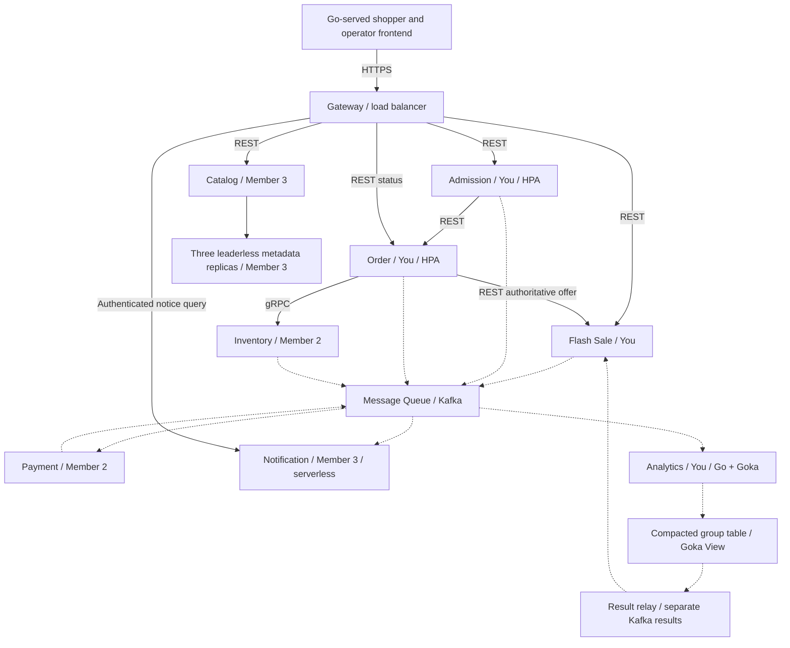

# Implementation Plan: Flash Sale Platform

**Branch**: `001-mukthish-implementation`
| **Date**: 2026-10-25 | **Spec**: [spec.md](spec.md)

**Input**: Feature specification from `specs/001-flash-sale-platform/spec.md`

## Summary

Plan the eight-service project with concrete technology choices only for Mukthish's
Admission, Flash Sale Manager, Order, Sales Analytics, frontend, gateway and Message Queue work.
Your stack is Go, Goka and Sarama with PostgreSQL for your transactional state. Other owners retain
control of their languages, frameworks, database engines and deployment tools. Shared contracts
preserve stock correctness, asynchronous payment, notifications, analytics and leaderless metadata.
[Research](research.md), [data model](data-model.md), [contracts](contracts/README.md) and
[validation guide](quickstart.md) complete Phase 1. This refresh incorporates all three decisions
from the 2026-10-25 clarification session: same-product schedules cannot overlap; a cumulative
per-shopper unit cap defaults to one; sale analytics exclude malformed, unauthorized and unknown-target
traffic. The subsequent Phase 1 implementation adds only workspace/setup tooling, generated bindings,
local dependencies and startup shells. Phase 2 now adds foundation primitives, real SQL/Kafka recovery checks and local lifecycle tooling.
Phase 3 implements sale publication/browsing. Phase 4 now implements Admission quotas and the
Order purchase/payment-success slice; failure recovery/refunds and deployments remain future work.

## Technical Context

**Language/Version**: Your components use Go 1.27.3. Analytics uses Goka v1.1.17 with IBM Sarama
v1.46.3; your other Kafka clients use the same Sarama version. Your frontend uses Go html/template
and small plain JavaScript modules served by the gateway. Python 3.11+ remains workflow/contract
tooling only. No teammate language or frontend/backend framework is prescribed for their services.

**Primary Dependencies**: For your code: standard net/http, html/template and slog; pgx v5;
grpc-go/protobuf for the Inventory client; a JWT validation library; Sarama; Goka processor/View
and its local cache. Share only generated contracts and small transport/auth/telemetry helpers;
business rules and saga state stay with their owners. Pin all versions/digests in implementation.

**Storage**: Your Flash Sale, Admission and Order each own PostgreSQL 17 databases/credentials.
Admission uses SQL quota rows and expiring leases. Flash Sale uses a PostgreSQL range exclusion
constraint for non-cancelled same-product schedules; Inventory owns atomic shopper allowance
enforcement alongside stock, without an engine being selected for Member 2. Analytics state is authoritative in Kafka's
compacted Goka group table, with rebuildable local caches and a durable-state result relay.
Raw retention is seven days; dedup/finalization retention is at least eight days. Inventory,
Payment, Catalog, Notification and custom-replica engine choices belong to their respective owners;
the shared data model defines guarantees, not their physical schemas or database versions.

**Testing**: For your code: Go testing, `_test.go`, `go test -race`, gofmt, go vet, staticcheck,
Goka tester plus real Kafka crash/rebalance/rebuild tests, Testcontainers-Go PostgreSQL/Kafka,
HTTP/DOM/browser journey checks and k6 load scenarios. Contract validation parses OpenAPI 3.1,
compiles Inventory protobuf and validates JSON Schema events/examples. Teammates choose their
own unit-test frameworks and supply adapter/test commands for shared acceptance checks.

**Target Platform**: Your Linux containers run on the agreed managed Kubernetes platform; local
Compose provides your PostgreSQL and Kafka KRaft dependencies (Docker or a rootless Podman API). Goka Analytics joins the
original six ordinary services as the seventh Kubernetes domain workload; Notifications remains
event-triggered serverless. Provider, IaC/GitOps products, function platform and teammate runtimes
are delegated to the platform/service owners. Kafka broker provisioning is your responsibility in
coordination with the platform owner; Sarama is its client library, not a replacement broker.

**Project Type**: Monorepo distributed web application and cloud/distributed-storage demonstration.

**Performance Goals**: Preserve SC-001-SC-015: 100-unit correctness sale; >=10,000 attempts over ten
minutes from >=50 shoppers; p95 browse/purchase <=2s, overload rejection <=1s; normal settlement
and notice <=10s at p95; unpaid holds reclaimed <=10s after 120s expiry; refund <=30s after recovery;
work resumes <=60s; finalized summary visible <=5s after lateness cutoff; replica convergence
<=60s for 100 products. Unexpected errors <1%. These are unmeasured acceptance targets.

**Constraints**: REST public/Admission-to-Order, gRPC Order-to-Inventory, Kafka raw/results separation,
serverless Notification, IaC, GitOps, resource-based Admission/Order HPA, Prometheus/Grafana,
centralized logs, public HTTPS and private internal operations. Three storage-product categories
remain required. The user's Goka choice explicitly supersedes the source's earlier Flink/managed
stream-runtime prescription. This does not change purchase or analytics business outcomes.

**Scale/Scope**: Eight domain services; three members with 4+2+2 ownership; three fixed leaderless
metadata replicas (N=3/R=2/W=2); six analytics partitions; one-product orders, quantity 1..100;
seven user stories. The configurable `per_shopper_unit_cap` initially equals one and is frozen at
sale start. It counts unexpired held plus confirmed units across all of a shopper's orders in a
sale; release/expiry frees allowance. Different products may have concurrent sales; same-product
windows may be adjacent. No cart, real payments, fulfillment, dynamic store membership or multi-region.

### Phase 1 implementation pins and evidence

Phase 1 T001–T008 uses pgx v5.11.0, grpc-go v1.84.0, Go protobuf v1.36.12,
golang-jwt v5.3.1, Prometheus client v1.25.0, Testcontainers-Go v0.44.0 and staticcheck v0.8.2.
Goka/Sarama and Go retain their previously selected exact versions. The local Kafka image is
4.0.2; PostgreSQL 17-bookworm and both runtime images are locked to immutable registry digests.
The standalone Compose client is v5.6.1 and supports the same Compose command/specification
boundary through Docker or a rootless Podman API. Python contract tools and transitive
requirements are version/hash locked. Go module/tool checksums and image/tool release checksums
are recorded in `dev/tool-versions.json`; module sums/workspace files retain resolved dependencies.

[Development instructions](../../docs/development.md) document the now-available setup commands.
[Phase 1 evidence](../../docs/evidence/phase1.md) distinguishes compiler/unit/scaffold checks,
real local dependency health and pending E4 adoption from later integration/runtime claims.
No peer implementation or cloud runtime is provisioned. Phase 2 T009–T020 is now complete; story tasks remain unchecked.

### Phase 2 foundation implementation

T009–T020 adds shared validation/authentication, controlled clock/fault seams, HTTP errors/deadlines,
owned SQL pools/migrations, event codecs, checked Sarama clients, inbox/outbox receipts and durable
retry/quarantine/replay. Runtime validation uses pinned jsonschema/v6 v6.0.2 against the embedded
reviewed schema, avoiding an incomplete parallel validator. Event structs are generated from that
same schema. Its module checksums are recorded with the other pins.

A tenth tooling module under `scripts/` owns the three planned Go CLIs; quality commands enumerate
it alongside the original nine modules. Fixture-only peers, owner adapter contracts, bounded
metrics/log correlation, health/readiness and local key/token/service-certificate seed are runnable.
Foundation readiness explicitly reports `business_ready=false`. [Phase 2 evidence](../../docs/evidence/phase2.md)
records real PostgreSQL/Kafka failure/recovery and local mTLS/runtime checks. E4 approval, real
E1/E2 acceptance, story behavior and cloud infrastructure remain pending.

### Phase 3 implementation and CLI browser checks

T021–T030 implement sale configuration/readiness, schedule exclusion, Admission projection,
explicit gateway routes and Go-served operator/storefront pages. Database exclusion is retained
alongside per-product transaction locks to prevent GiST check deadlocks. Operator GET sale and
`X-Sale-Freeze-At` are draft contract additions for readiness polling and original-boundary UI freeze;
E4 remains pending. No teammate service or storage is implemented.

The user explicitly requested Playwright from the CLI for browser verification. Development-only
Node.js 22+ and exact `@playwright/test` 1.64.1 are recorded in `frontend/package.json`/lockfile and
`dev/tool-versions.json`; Go remains the application runtime. `make browser-bootstrap` installs the
locked test dependency and matching Chromium under ignored local paths. `make test-browser` runs
real sale APIs with controlled Catalog browser responses and records desktop/mobile screenshots;
`make test-frontend` runs fast DOM-boundary checks. No browser extension is required.

Local setup precreates only three US1 fixture topics from `dev/topics.json`, six partitions and one
broker. This is separate from later shared topic/IaC/GitOps work. Forward foundation repairs preserve
migration checksums, nullable poison records, dictionary validation, retry-pool capacity, stable
seeded subjects and visible outbox delivery failures. [US1 evidence](../../docs/evidence/us1.md)
distinguishes these local checks from unavailable real peer/platform acceptance.

### Phase 4 purchase implementation

T031–T045 add ordered SQL quotas and two-second Admission leases, eligible attempt snapshots,
fenced durable PurchaseIntents, authoritative offer checks, the mTLS/gRPC Inventory client,
Order acceptance/payment-success, explicit gateway routes and checkout/status pages. Production
quota time comes from PostgreSQL after row locks; tests supply controlled time. Worker claims last
five seconds and always retain the proposed Order ID. Successful payment uses its event correlation
on downstream RPCs. No new dependency version or peer implementation is introduced.

The three purchase demos use isolated owner SQL and contract scripts; purchase-success also
crosses actual gRPC/Kafka. The test owner verifier requires complete matching run/sale/shoppers/
reservation/outcome evidence and rejects fixture-mode or insufficient evidence. E1 remains
unavailable for actual cap/no-oversell/settlement acceptance; E4 remains pending. Phase 5 owns the
autonomous intent/saga reconciliation and failure/refund work. See [US2 evidence](../../docs/evidence/us2.md).

### Architecture and boundaries



Your gateway is a route/auth/template adapter with no saga or business-data credentials. Flash
Sale owns authoritative offers and its operator analytics projection. Admission owns shared quotas.
Order owns durable purchase intents and saga progress. Inventory alone decides stock transitions;
Payment records stable charge/refund outcomes; Notification deduplicates notices; Catalog owns its
metadata client and offers projection. Goka processor, View and results relay are one Analytics
responsibility; they do not add another domain service.

Each state owner uses its own credentials. Business changes and follow-up events commit together;
consumers persist inbox dedup before acknowledging. Kafka destination receipts keep domain and
analytics copies durable with the same event ID. No cross-topic ordering is assumed. Inventory's
locked authoritative time decides expiry; an ambiguous successful Confirm is queried before
Order confirms or compensates. [data-model.md](data-model.md) contains all transition/recovery rules.

### Clarified sale and purchase rules

Flash Sale stores `[starts_at, ends_at)` as a `tstzrange` and uses a GiST exclusion constraint over
product equality and range overlap, applying only where `cancelled_at IS NULL`. Enable `btree_gist`
in your database. Creation and pre-start replacement commit configuration plus outbox together;
an advisory SELECT check alone cannot arbitrate concurrent writers. Map exclusion violations to
HTTP 409 `SALE_WINDOW_CONFLICT`. Adjacent windows and different products are permitted, and
cancellation frees that interval atomically. The sale's current version and original start guard
still prevent conflicting edits or bypassing the freeze. [R9](research.md#r9-prevent-overlapping-same-product-sales)
records the PostgreSQL sources and alternatives.

Use the same normalized `per_shopper_unit_cap` in the operator form, public/internal offers,
SaleConfigured/SaleActivated and readiness digest. An omitted SaleWrite input defaults to one;
canonical responses/events always include it. A pre-start replacement changes the version and
invalidates all readiness; no cap edit is allowed after the start boundary.

Inventory must serialize the stock check, `(sale_id, shopper_id)` allowance check, reservation and
outgoing effects as one protected decision. Existing matching Reserve results replay before a
fresh limit check; distinct order IDs cannot bypass the cap. Expired holds stop counting at the
locked authoritative time even when cleanup is late. Confirm transfers held to sold without
freeing allowance; release/expiry frees it once. Order maps `PURCHASE_LIMIT_EXCEEDED` to a durable
HTTP 409 rejection, with no payment; a later new purchase after allowance is freed requires a new
request key. Your gateway displays the cap and specific rejection; it never authorizes allowance
from an in-memory counter. Member 2 supplies the transactional implementation and verifier adapter.

The 2026-10-25 `$speckit-tasks` refresh carries these decisions into Mukthish's 100 unchecked
T001–T100 tasks, preserving IDs and completion state. It covers overlap/cap/eligibility scenarios,
cap-aware load identities, peer handoffs and draft.2 adoption; no teammate backlog is generated.

### Your analytics design

Use Goka's persisted group table keyed by sale/product/minute window. The input and table topics
have six partitions and the same hash; producer partitioners and recovery tests enforce that
mapping. Choose windows from occurrence time, and use broker LogAppendTime as stable arrival time.
Your clock emitter queries Flash Sale's schedule endpoint and appends per-window heartbeat records
once per second. It also schedules heartbeats for nonfinal keys in its recovered View, including
windows created by eligible attempts before or after a sale's active interval. The same ordered
input partition therefore carries data and finalization markers, including empty windows. At/after end+60s, new input for that window is late; a marker finalizes it.
A replay does not substitute the current wall clock for the original record's arrival/cutoff.

The processor persists counts, exact distinct/seen sets, revision/final flag and output identities;
it does not emit an uncommitted result. A Goka View sees durable state changes, and a retrying
Sarama relay publishes those stored results. On restart/rebalance it waits for recovery and queues
stored outputs again. Duplicate results have deterministic event IDs and the same revision;
Flash Sale replaces only newer revisions. Late output identities remain replayable in state too.
This is at-least-once delivery with repeat-safe business outcomes, not a claim of transactional
exactly-once Goka output. State/output/offset interruption tests are required.

Keep compact-only state topics, eight-day dedup/finalization data, bounded per-window state size,
startup cache rebuild and partition-reassignment evidence. Your one-second tick and relay cadence
leave three seconds for processing/projection within SC-009's five-second healthy-workload budget.
A lagging emitter, unrecovered View or Kafka outage marks results delayed instead of reporting
fresh zero sales. Avoid blind partition-count changes; rebuild/repartition with a reviewed migration.

### Analytics eligibility and operational traffic

Admission creates AttemptRecorded only after shopper authentication, request/schema/header
validation and resolution of a known sale with its matching product. Known inactive, cancelled or
not-ready sales still produce eligible attempts. Every explicit retry has a new attempt ID, while
internal redelivery preserves it. Malformed, unauthorized and unknown/mismatched-target submissions
produce operational exclusion counts at the rejecting boundary, with no placeholder identities or
analytics event. Gateway and Admission classify a submission once; defense-in-depth checks do not
multiply the count. Use bounded reason labels, never raw tokens, request bodies or shopper IDs.

An admitted request that Order later rejects for stock or purchase cap remains `ADMITTED/NONE` for
the admission decision. Its AttemptRecorded carries the final HTTP status and `response_error_code`.
It contributes one attempt and response latency, not an extra admission rejection. Admission
rejection rate remains rejected eligible admission decisions divided by all eligible admission
decisions. Golden mixed-traffic fixtures verify unchanged sale totals for excluded traffic and
separate operational counts. [R11](research.md#r11-define-sale-analytics-eligibility) records this boundary.

### Team ownership and delegated choices

| Owner | Domain services | Supporting scope | Concrete stack choices in this plan |
| --- | --- | --- | --- |
| Mukthish | Admission, Flash Sale, Order, Analytics | Frontend, gateway, Message Queue; (c) HPA/load and (e) streaming | Go, Goka, Sarama, your PostgreSQL and validation tools |
| Member 2 | Inventory, Payment | Platform/IaC (a), GitOps (d), observability (h) | Chosen by Member 2; shared contracts/guarantees only |
| Member 3 | Catalog, Notification | Communications/serverless (b), leaderless concept (f), storage products (g) | Chosen by Member 3; shared contracts/guarantees only |

Members supply their preferred language, database/storage implementation, start/test adapters and
platform products in owner-maintained planning notes before their implementation. These are
explicitly delegated decisions and do not require choosing a stack on their behalf here. Create
`task_divison.txt` with actual names at implementation scaffolding; no application/task files are
created in this planning command. Required consumer reviews remain pre-implementation/merge gates.

### Platform integration contract

The platform owner supplies managed Kubernetes capacity, public HTTPS, private service networking,
secrets/service identities, persistent storage for the concept replicas and a serverless event/query
adapter for Notification. You supply container health/readiness endpoints, resource requests,
shutdown/draining behavior, broker configuration and dashboards/metrics for your components. All
infrastructure is versioned IaC; application updates reconcile through a tracked Git repository.
No direct manual service deployment replaces GitOps. No specific provider or paid product is chosen.

Admission and Order start with HPA min=1/max=6, CPU target 60%, requests 100m/128Mi, limits
1CPU/512Mi, scale-up stabilization 30s and scale-down 300s. Platform must supply resource metrics
and worker headroom. Measure real-path demand and tune versioned settings; do not add fake CPU work
to trigger scaling. Analytics starts with one processor; a second instance is used for rebalance
recovery tests, never more active processors than its six partitions.

Prometheus/Grafana show request rates, errors, latency, outbox/consumer lag, stock/refund state,
Goka recovery/view lag and replica health. Logs from all eight services are centralized, including
the serverless handler. Propagate correlation/event/order IDs; exclude secrets/tokens and
high-cardinality shopper metric labels. Rollback uses reviewed versioned revisions, compatible
schema evolution and retained business state; cache rebuild is not loss of authoritative data.
Three distinct product uses remain transactional state, object media/evidence, and independent
replica block storage. Provider/product selection and actual spend are the owners' deployment inputs.

### Delivery and validation

1. Review shared contracts with consumers; scaffold your Go workspace, fixtures and local commands.
2. Complete sale readiness and one purchase with teammate-supplied contract mocks/adapters.
3. Replace mocks with real Inventory/Payment/Notification; complete failure, expiry, compensation
   and every ambiguous-boundary recovery case.
4. Implement Goka aggregation, state-view relay and golden/replay tests; integrate Catalog's
   quorum/conflict/recovery through its language-neutral contract.
5. Integrate the owners' platform choices, then capture public access, rollback, HPA, logs/metrics,
   storage-product and individual demonstration evidence.

Mocks allow independent progress; only real cross-service runs pass final acceptance. Commands
below are future implementation deliverables; [quickstart.md](quickstart.md) identifies what can
run now and the expected end-to-end results. Go tests run per module rather than assuming
workspace-root `./...` covers every module. No teammate test framework is mandated.

| Planned command | Evidence |
| --- | --- |
| `make fmt-check lint typecheck contracts-check` | Your gofmt/vet/staticcheck/compiler; JSON/OpenAPI/protobuf; generated-client drift; teammate checks through supplied adapters |
| `make test-unit` | Your Go rules, Goka tester, clocks, validation and template/HTTP behavior |
| `make test-integration` | PostgreSQL/Kafka, outbox/inbox, Goka table/view relay, rebalance/rebuild and teammate interfaces |
| `make test-races` | Schedule overlap conflicts, shopper-cap races across distinct keys/instances, oversell, same-key concurrency, expiry/Confirm and lost-response recovery |
| `make test-e2e` | All seven stories through real service adapters and access checks |
| `make demo SCENARIO=...` | Deterministic scenario reports with IDs, outcomes and invariant evidence |
| `make load PROFILE=correctness` | 100 units/10,000 attempts from at least 100 shoppers at cap=1; timings, stock and per-shopper allowance ledgers |
| `make load PROFILE=scaling` | Sustained real demand, both HPA increases, resource/limit evidence |

| Requirements / outcomes | Verification | Owner |
| --- | --- | --- |
| FR-001-FR-004; SC-001/014 | Sale readiness/version/cap digest, overlap races/adjacency/cancellation, offer/role and own-record checks | Mukthish + Member 3 |
| FR-005-FR-010; SC-002/003/004 | Shared quotas, cross-key shopper cap and expiry/release allowance, durable request identity, stock ledger, offer mismatch | Mukthish + Member 2 |
| FR-011-FR-017; SC-005/006/007 | Payment/refund stability, races, interrupted transitions, retry/quarantine | Mukthish + Member 2 |
| FR-018-FR-019; SC-008 | Canonical notices, failure/replay and independent progress | Member 3 |
| FR-020-FR-022; SC-009 | Eligible/excluded mixed traffic, admission vs downstream outcomes, event-time cutoffs, golden totals, stable output and recovery | Mukthish |
| FR-023-FR-026; SC-010 | Quorums, conflicts, uncertain writes, durable recovery and repair | Member 3 |
| FR-027-FR-033; SC-011/012/013/015 | Platform access, IaC/GitOps/rollback, HPA, storage and all-service evidence | Member 2 + all |
| FR-034-FR-035 | Ownership, command documentation, quality gates and contracts review | All |

### Design validation performed

On 2026-10-25, the clarification refresh passed validation of all three OpenAPI 3.1 documents,
127 local schema references, 24 event examples, 72 malformed-event rejection controls, five HTTP
request/response examples, and 20 cap/error contract controls. The readiness digest fixture is
synchronized with its cap-aware configuration. Inventory protobuf compiled with four RPCs and the
appended PURCHASE_LIMIT_EXCEEDED result code. Shared schema copies, Markdown links and eight
quickstart shell blocks passed; the accepted spec and existing task state were preserved.

These checks validate design artifacts. No application/runtime/cloud checks or teammate approvals
are claimed. The complete validation run and descriptors were kept under `/tmp`; Spec Kit
prerequisites and final repository whitespace are checked again after applying the refresh.

## Constitution Check

*GATE: Must pass before Phase 0 research. Re-check after Phase 1 design.*

| Gate | Before research | After Phase 1 | Evidence / required follow-through |
| --- | --- | --- | --- |
| I. Readable, Consistent Code | PASS | PASS | Mukthish's Go stack, small shared helpers, explicit quality commands |
| II. Explicit Boundaries and Contracts | PASS | PASS | Owned state; revised REST/protobuf/events; cap digest and draft migration/review gate; teammate stacks delegated |
| III. Behavior-Based Verification | PASS | PASS | FR/SC mapping, overlap/cap/mixed-traffic fixtures, controlled clocks and real-adapter guide |
| IV. Distributed Correctness Under Failure | PASS | PASS | Atomic stock/allowance and expiry races; database schedule exclusion; Goka durable state/relay; concept repair |
| V. Maintainability and Operational Clarity | PASS | PASS | Owners, command contracts, health/logs/metrics and rollout/recovery |
| Latest user/source scope | PASS | PASS | Explicit Goka/Sarama amendment, Kafka retained, no teammate stack mandates |

These are design-compliance results, not completed runtime checks or teammate approvals. No
constitution exceptions are required. The latest user instructions authorize the recorded engine
and ownership-scope amendment. Owner-delegated technology choices and environment credentials are
handoff inputs; they are not unresolved decisions within the requested stack for Mukthish.

## Project Structure

### Documentation (this feature)

```text
specs/001-flash-sale-platform/
├── spec.md
├── plan.md
├── research.md
├── data-model.md
├── quickstart.md
├── checklists/requirements.md
├── contracts/
│   ├── README.md
│   ├── public.openapi.json
│   ├── internal.openapi.json
│   ├── catalog-store.openapi.json
│   ├── inventory.proto
│   ├── events.schema.json
│   └── examples.json
└── tasks.md                     # Mukthish backlog refreshed for the accepted clarifications
```

### Source Code (repository root)

```text
services/
  admission/                    # Your Go service
  flash-sale/                   # Your Go service and results projection
  order/                        # Your Go saga service
  analytics/                    # Your Go/Goka processor, View and relay
  inventory/                    # Member 2; owner-chosen stack
  payment/                      # Member 2; owner-chosen stack
  catalog/                      # Member 3; owner-chosen stack
  notification/                 # Member 3; owner-chosen serverless stack
storage/catalog-kv/             # Member 3; owner-chosen implementation
frontend/                      # Your Go templates and plain JavaScript assets
gateway/                       # Your Go routes, auth and frontend serving
contracts/                     # Future canonical reviewed contract release/bindings
internal/platform/             # Small helpers for your Go code only
infra/                         # Member 2; owner-chosen IaC tooling
deploy/                        # Shared desired state; owner-chosen GitOps tooling
dev/                           # Local dependencies and owner-supplied adapters
scripts/                       # Validation and fixture tooling
tests/                         # Shared contract/end-to-end/load/fault evidence
task_divison.txt               # Future required ownership record
Makefile                       # Future integration command contract
go.work                        # Your Go modules only
```

**Structure Decision**: One monorepo; your components are independently testable Go modules.
Teammate directories are boundaries, not generated code or chosen build systems. Source paths
now include Mukthish's Phase 1 modules and startup shells; peer paths and later story files are
future artifacts. This design updates feature-local design/contracts using the already clarified
specification. The subsequent `$speckit-tasks` refresh updates only Mukthish's implementation
backlog, with the same owner handoff boundaries. Draft contract revision 2 and its coordinated adoption plan are in the
[compatibility gate](contracts/README.md#compatibility-and-review-gate).

## Complexity Tracking

No constitutional exceptions. The eight responsibilities and concept replicas come from the source;
Goka/Sarama and stack selection for Mukthish come from the user's later instructions. Kafka group
state and the result relay add recovery work that is explicitly tested; no transactional exactly-once
claim hides that work. SQL admission avoids an additional cache at the current scale. Other members'
stack choices remain theirs, while interfaces and observable guarantees stay shared.
