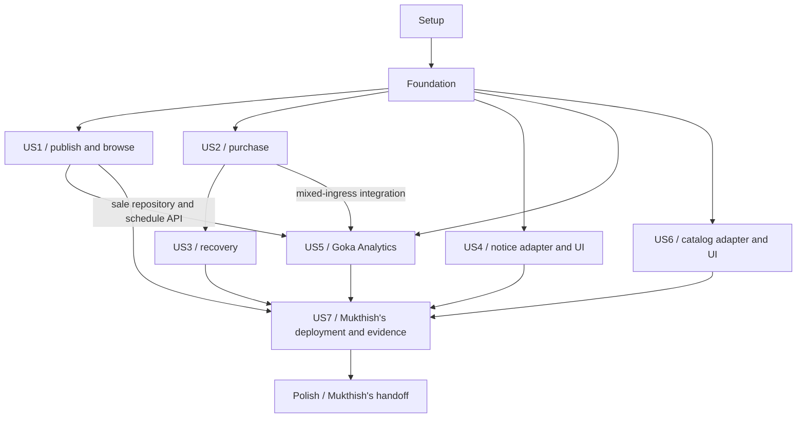

# Tasks: Flash Sale Platform — Mukthish

**Input**: [plan.md](plan.md), [spec.md](spec.md), [research.md](research.md),
[data-model.md](data-model.md), [contracts](contracts/README.md) and [quickstart.md](quickstart.md)
from `specs/001-flash-sale-platform/`.

**Prerequisites**: Completed Phase 1 design and Constitution v1.0.0; refreshed 2026-10-25 against
all three accepted clarifications and shared contract `1.0.0-draft.2` (published on `main` as
`a9aff54`). Existing T001–T100 IDs are preserved; Phase 1 completion is recorded below.
**Clarified coverage**: Same-product overlap prevention, cumulative per-shopper cap (initially one),
eligible sale analytics vs excluded operational traffic, cap-aware readiness, and sufficient load
identities/caps. This is a local backlog refresh; generation does not execute or publish implementation.
**Scope**: Only your Admission, Flash Sale Manager, Order, Sales Analytics, frontend, gateway,
Message Queue, and your integration/HPA/load evidence. Go 1.27.3, Goka v1.1.17 and IBM Sarama
v1.46.3 apply to your code. Kafka remains the broker. Teammate stacks remain their choice.
**Tests**: Included because FR-035 and Constitution III/IV explicitly require automated behavior,
contract, concurrency, failure and recovery verification. Write story checks before implementing
the behavior and demonstrate the intended failure, then make them pass. Documentation-only changes
receive path/command/consistency checks rather than redundant test suites.
**Organization**: Keep all seven original story IDs for traceability, with only your slice of US4,
US6 and US7. Every checkbox belongs to you; the external-deliverable table is not a teammate task list.

**Implementation progress (2026-10-25)**: Phases 1–3 T001–T030 are complete. Phase 3 also closes
US1 consolidation checks T104/T114 and consumer prerequisites T113/T118/T119/T122/T128.
[Phase 1 evidence](../../docs/evidence/phase1.md), [Phase 2 evidence](../../docs/evidence/phase2.md)
and [US1 evidence](../../docs/evidence/us1.md) distinguish historical foundation checks from current
sale, route, race, real SQL/Kafka, live runtime and Playwright desktop/mobile evidence. E4 remains
pending; actual E1/E2 readiness/browsing and purchase/cloud acceptance remain unverified. The 129-task
backlog has 37 checked and 92 pending tasks. Historical convergence assessments below are retained;
T121/T127 have partial improvements but remain open for their complete acceptance scope.

## Format: `[ID] [P?] [Story] Description`

- Each task has a sequential T ID; `[X]` records verified completion and `[ ]` remains pending. Story phases carry US1–US7.
- `[P]` means the listed sibling tasks can run together after their named prerequisites and the
  phase gate are satisfied; it does not permit skipping prerequisites or concurrent file conflicts.
- `after T...` records task dependencies; phase gates and the story graph also apply.
- An `E1`/`E2`/`E3` requirement blocks only the real external acceptance run, not your independent
  fixture-based development. An unavailable run stays unchecked/unverified; a double never proves
  a real service's guarantee. A recorded report with missing evidence does not satisfy that task.
- Source constraints are quoted in relevant task descriptions; current schemas supply all remaining
  required/optional fields, lengths, numeric bounds and enums. Do not reinterpret them during coding.

## Path Conventions

All code paths are repository-relative future artifacts. Your roots are `services/admission/`,
`services/flash-sale/`, `services/order/`, `services/analytics/`, `frontend/`, `gateway/`, and the
shared contract, helper, local-dependency, messaging and test paths explicitly named below.
No task implements `services/inventory/`, `services/payment/`, `services/catalog/`,
`services/notification/`, `storage/catalog-kv/` or the shared `infra/` platform.

Your doubles under `tests/doubles/` implement only controlled contract responses for testing;
they are not alternate production peer services. Provider-specific cloud resource creation,
serverless implementation, replica storage/repair, shared monitoring/log infrastructure and peers'
unit frameworks stay outside this list. Your application desired state and metrics are integration
inputs to their owners. No source, runtime or deployment is created by generating this task file.

| External dependency | Existing owner / required interface | Where it matters |
| --- | --- | --- |
| E1 | Member 2: cap-aware live Inventory RPCs/stable Reserve outcomes, Payment/refund events and read-only stock/shopper-allowance verifier with expiry/cleanup-pause fault controls | Real purchase, cross-key cap/no-oversell, expiry/compensation and load evidence |
| E2 | Member 3: live Catalog/leaderless failure adapter and serverless Notification query/event adapter | Actual browsing/readiness, notices and concept recovery evidence |
| E3 | Member 2/platform: managed cluster, broker hosting connectivity, metrics/headroom, HTTPS, identities and GitOps entry point | Your broker configuration, application release, HPA and live evidence |
| E4 | Affected producer/consumer reviewers: draft.2 cap/digest/error adoption and recorded compatibility review | Producer/consumer adoption and applicable integration/merge gate; publishing a draft on main is not approval |

These are handoff interfaces only. Roles come from the agreed ownership baseline; no teammate
implementation work or technology choice is assigned by this document.

## Phase 1: Setup (Shared Infrastructure)

**Goal**: Initialize only Mukthish's workspace, local dependencies, reviewed contracts and repeatable commands.

**Independent Test**: Each of Mukthish's modules builds its empty entry point; local PostgreSQL/Kafka are healthy; contract checks run without any teammate source.

- [X] T001 Create your Go module layout and Go 1.27.3 workspace in `go.work`, `services/admission/go.mod`, `services/flash-sale/go.mod`, `services/order/go.mod`, `services/analytics/go.mod`, `gateway/go.mod`, `frontend/go.mod`, `internal/platform/go.mod`, `contracts/go.mod` and `tests/go.mod`; use the existing `flash-sale` contract import prefix and exclude teammate source modules.
- [X] T002 Pin Goka v1.1.17, IBM Sarama v1.46.3, pgx v5, grpc-go/protobuf and the selected JWT/test/metric tooling in your `go.work.sum` and Mukthish's `go.mod`/`go.sum` files; use one Sarama version through Goka and direct clients and retain tool checksums in `dev/tool-versions.json`. (after T001)
- [X] T003 Promote the seven feature `contracts/` artifacts at `1.0.0-draft.2` into root `contracts/` and generate only your Go bindings under `contracts/gen/`; implement schema/example/protobuf/source-drift checks in `scripts/validate_contracts.py` and `contracts/generate.go`. Check required canonical cap fields, optional SaleWrite default=1, SALE_WINDOW_CONFLICT/PURCHASE_LIMIT_EXCEEDED, cap-aware digest fixtures and conditional response_error_code; record draft adoption/review state and reject cap-unaware integration without E4 rather than claiming prior-draft compatibility. (after T002)
- [X] T004 [P] Define your PostgreSQL 17 databases and Kafka KRaft dependency with pinned images, health checks, separate named volumes and run-isolated settings in `dev/compose.yaml` and `dev/postgres/init.sql`; enable `btree_gist` only in your Flash Sale database and include peer adapter hooks without choosing or implementing teammate runtimes. (after T003)
- [X] T005 [P] Create documented non-secret configuration and disposable local-key/token locations in `dev/lead.env.example` and `.gitignore`; define separate Flash Sale, Admission and Order credentials, peer endpoint inputs and fail-closed configuration validation without committed credentials. (after T003)
- [X] T006 [P] Create Mukthish's format/lint/compiler/race-test and contract-check commands in `Makefile`, `ci/lead-checks.sh` and `staticcheck.conf`; enumerate your modules rather than assuming workspace-root `go test ./...` covers them, and make unimplemented application targets fail clearly. (after T003)
- [X] T007 [P] Record only your four service assignments and frontend/gateway/Message Queue plus categories (c)/(e) responsibilities in `task_divison.txt`; document peer deliverables as external interfaces in `docs/lead-boundaries.md` without assigning their implementation stack or tasks. (after T003)
- [X] T008 Add configuration-driven startup and graceful shutdown skeletons in `services/admission/cmd/server/main.go`, `services/flash-sale/cmd/server/main.go`, `services/order/cmd/server/main.go`, `services/analytics/cmd/server/main.go` and `gateway/cmd/server/main.go`, and an embedded asset package in `frontend/embed.go`. (after T004, T005, T006, T007)

**Checkpoint**: Passed on 2026-10-25: all nine modules build, contract checks pass, PostgreSQL/Kafka are healthy, and your five startup shells stop cleanly. No teammate application source is created.

---

## Phase 2: Foundational (Blocking Prerequisites)

**Goal**: Provide Mukthish's primitives and test seams required by every story. Complete this phase before story implementation.

**Independent Test**: Run foundation tests against real local SQL/Kafka and contract doubles; prove rollback, repeat handling, identity filtering and offset ordering.

- [X] T009 [P] Implement shared value validation with boundary tests in `internal/platform/value/value.go` and `internal/platform/value/value_test.go`; quote-preserve "IDs are UUID strings", "UTC RFC 3339", "between 0 and 9,007,199,254,740,991", "Sale unit prices are positive.", "Quantity is an integer from 1 to 100 in this release", "No cross-currency addition is permitted." and "Request keys are 1-128 printable ASCII characters."; enforce currency `^[A-Z]{3}$`, overflow checks and required/optional fields from the reviewed schemas. (after T008)
- [X] T010 [P] Implement your JWT verifier and service-context authentication in `internal/platform/auth/auth.go` with role/expiry/forged-header tests in `internal/platform/auth/auth_test.go`; enforce "role: SHOPPER|OPERATOR", "15-minute JWTs signed with a generated RSA key", issuer/audience/expiry and authenticated service subjects; never add a public token-minting route. (after T008)
- [X] T011 [P] Provide controlled UTC time, UUID/correlation generation and failpoint interfaces in `internal/platform/clock/clock.go` and `internal/platform/fault/fault.go`; deterministic tests must advance conditions explicitly rather than use arbitrary sleeps. (after T008)
- [X] T012 Implement your shared JSON error/validation middleware and route registration primitives in `internal/platform/httpapi/http.go`; preserve Error enums including SALE_WINDOW_CONFLICT and PURCHASE_LIMIT_EXCEEDED, optional retry_after_seconds/current_offer, HTTP 400/401/403/404/409/429/503 and correlation IDs. A stable cap rejection is 409, retryable=false, without Retry-After; forward remaining deadlines rather than stacking timeouts. (after T009, T010, T011)
- [X] T013 Implement your transactional migration runner and per-owner connection pools in `internal/platform/postgres/migrate.go` and `internal/platform/postgres/pool.go`; track applied checksums and roll back failed migrations without cross-service database writes. (after T012)
- [X] T014 Implement your envelope codec and typed event bindings in `internal/platform/events/envelope.go`; preserve "schema_version=1", UUID IDs, UTC times, owner/entity aggregate versions and producer/topic rules. Draft.2 SaleConfigured/SaleActivated require per_shopper_unit_cap; AttemptRecorded retains distinct admission decision/reason, final response_status and response_error_code for HTTP >=400. Known-major consumers tolerate harmless optional additions and quarantine invalid payloads/unknown kinds or majors. (after T003, T009)
- [X] T015 Implement your checked Sarama producer/consumer builders in `internal/platform/messaging/sarama.go` with real-Kafka tests in `tests/integration/sarama_delivery_test.go`; enforce `Producer.RequiredAcks=WaitForAll`, `Producer.Idempotent=true`, `Net.MaxOpenRequests=1`, returned successes/errors and offset acknowledgement only after durable handler completion. (after T014, T004)
- [X] T016 Implement reusable inbox/outbox/destination-receipt storage and crash tests in `internal/platform/eventstore/store.go`, `internal/platform/eventstore/schema.sql` and `tests/integration/outbox_recovery_test.go`; enforce unique "consumer_name, event_id", separate domain/analytics receipts and retention until both destinations acknowledge, with business change/inbox/outbox in one owner transaction. (after T013, T015)
- [X] T017 Implement retry scheduling, inspectable quarantine and authorized audited replay for your consumers in `internal/platform/messaging/retry.go` and `scripts/cmd/replay/main.go`; retain original identity/payload/topic/partition/offset and use "five delayed retries at 1/2/4/8/16 seconds", pausing dependency-wide outages while preserving business obligations. (after T016)
- [X] T018 Create contract-limited Inventory gRPC, Payment event, Catalog REST and Notification query doubles under `tests/doubles/` with entry point `tests/doubles/cmd/server/main.go`; provide scripted cap rejections, matching rejected/successful Reserve replays, current terminal states, clock/cleanup delays and controlled timeouts/faults for consumer tests. Do not implement a production stock/allowance engine; fixture evidence is separate from E1/E2 acceptance. (after T003, T010, T011, T015)
- [X] T019 Define URL/credential, start/health/fault/read-only-verification adapter inputs and explicit unavailable-dependency results in `tests/adapters/contract.go`, `dev/adapters.example.json` and `docs/peer-adapter-contract.md`; require E1 stock and shopper/sale reservation ledgers, stable Reserve results, controlled expiry/paused cleanup and restart hooks. Verify "unexpired_held_units + confirmed_units <= per_shopper_unit_cap" via owner adapters without inspecting/migrating teammate databases. (after T018)
- [X] T020 Implement your lifecycle/health/readiness hooks, structured log correlation and bounded metric registration in `internal/platform/runtime/runtime.go` and `internal/platform/telemetry/telemetry.go`; wire entry points, identity/adapter fixtures and condition-based bootstrap/dev-up/migrate/seed/wait-ready in `scripts/cmd/dev/main.go` and `Makefile`. Create the scenario/command registry in `tests/scenarios/registry.go` and `scripts/cmd/demo/main.go` now so later story tests/demos can register and run before US7; business fixtures arrive in their story phases. (after T017, T019)

**Checkpoint**: Passed on 2026-10-25: foundation value/auth/transport tests, real SQL/Kafka rollback/recovery and five-process health/mTLS smoke checks pass. Story work may begin within the pending E4 review gate; peer service doubles are test boundaries, not accepted implementations.

---

## Phase 3: User Story 1 - Publish a sale and browse its products (Priority: P1) — MVP

**Goal**: Implement your Flash Sale configuration/readiness, Admission configuration projection, gateway browsing and operator/storefront UI.

**Independent Test**: With controlled Catalog/Inventory acknowledgements and real Flash Sale SQL, publish a 100-unit sale at cap=1, race same-product creation/rescheduling, allow adjacent/different-product windows, release a cancelled window, and verify cap digest, readiness, schedule and freeze rules.

### Tests for User Story 1

- [X] T021 [P] [US1] Write failing public/internal sale and Catalog-proxy contract tests in `tests/contract/us1_sale_routes_test.go`; cover operator denial, SaleWrite omission normalizing cap to one for create/replace, canonical cap presence/bounds, current-version freeze including cap/window, stale readiness, path/body-ID mismatch and HTTP 409 SALE_WINDOW_CONFLICT (FR-001–FR-004, SC-001/SC-014).
- [X] T022 [P] [US1] Write failing real-SQL/Kafka readiness/activation and schedule-race tests in `tests/integration/us1_readiness_test.go`; race same-product create/create, create/replace and replace/replace across instances, verify at most one conflicting commit, permit adjacency/different products and reuse a pre-start cancelled window. Check duplicate/obsolete versions, missing participants, cap-aware digest mismatch, activation interruption/replay and no rejected-configuration outbox effect (US1.1–7, SC-001).

### Implementation for User Story 1

- [X] T023 [US1] Model configuration/readiness in `services/flash-sale/internal/sale/model.go` and `services/flash-sale/migrations/001_sales.sql`; preserve "cancelled_at?, frozen_at?", unique "(sale_id, version, participant)", participant values "Catalog, Admission, or Inventory", positive allocation/price, "starts_at < ends_at" and cap "initial default one". Normalize omitted SaleWrite cap to one, validate positive safe-integer bounds, persist explicit cap and enforce product equality/range overlap exclusion using half-open tstzrange, GiST/btree_gist and "cancelled_at IS NULL". Keep expected_version=0 for create and current-version mutation; reject conflicts atomically. (after T021, T022)
- [X] T024 [US1] Model Admission applied sale/version/activation/cap projection in `services/admission/internal/sale/model.go` and `services/admission/migrations/001_sales.sql`; retain inactive/cancelled known-target identities for analytics and preserve "Once the original start time is reached, price/allocation/cap/window replacement is rejected" with the documented effective statuses. This projection is not stock or shopper-allowance authority. (after T023)
- [X] T025 [US1] Implement readiness consumption, canonical digest computation and the activation/schedule worker in `services/flash-sale/internal/sale/readiness.go`; hash normalized IDs/version/price/currency/allocation/cap/schedule/admission limits using "sorted-key compact UTF-8 JSON (no whitespace), lowercase UUIDs and normalized UTC times." Exclude status/readiness, verify the shared digest vector, require matching Catalog/Admission/Inventory version+digest, persist activation/outbox together and recheck end time after restart. (after T024)
- [X] T026 [US1] Implement authorized sale create/replace/cancel and public/internal authoritative offers in `services/flash-sale/internal/http/sales.go`; map the database exclusion conflict to 409 SALE_WINDOW_CONFLICT without mutation, enforce the original start/cap freeze and path/body-ID match, and commit SaleConfigured/SaleCancelled outbox with the accepted configuration. Cancellation atomically releases its excluded interval; canonical offers/events include the normalized cap. (after T025)
- [X] T027 [US1] Implement your SaleConfigured/SaleActivated/SaleCancelled consumer and cap-aware SaleReady publication in `services/admission/internal/sale/consumer.go`; validate explicit cap and the shared digest, buffer/reconcile early activation, ignore obsolete versions and retain schedule checks. A missing canonical cap is invalid, never unlimited; version/cap changes invalidate prior readiness. (after T026)
- [X] T028 [US1] Implement your explicit sale/Catalog browsing routes in `gateway/internal/routes/sales.go` and Catalog client in `gateway/internal/catalog/client.go`; preserve public schema errors and unavailable/conflicting metadata without choosing Catalog storage or deriving authoritative charges from its display offer. (after T027)
- [X] T029 [US1] Implement the operator sale form/readiness display and shopper product/offer views in `frontend/templates/sales.html`, `frontend/templates/products.html` and `frontend/assets/sales.js`; default the editable pre-start per_shopper_unit_cap to one, display canonical cap, preserve schema bounds/role gates/statuses and explain overlap conflicts. Freeze cap/schedule edits at start and require revised configuration readiness before purchase. (after T028)
- [X] T030 [US1] Register sale-readiness and sale-overlap with isolated schedule fixtures in `tests/scenarios/us1_sale.go`; make the contract/race/browser checks green and record fixture-only evidence in `docs/evidence/us1.md`. Demonstrate concurrent conflict, adjacency/different-product success, cancelled-window reuse, default/frozen cap and digest mismatch, then use live E1/E2 readiness adapters before claiming cross-service acceptance. (after T029)

**Checkpoint**: Passed in local fixture mode on 2026-10-25: US1 contracts, schedule races,
readiness/activation recovery, live runtime/mTLS and Playwright desktop/mobile journey. Actual
Catalog/Inventory readiness/browsing remains E1/E2-gated; E4 review is pending.

---

## Phase 4: User Story 2 - Purchase scarce stock without overselling (Priority: P1)

**Goal**: Implement your shared Admission limits and Order happy path, request identity, Inventory client and purchase/status UI.

**Independent Test**: Use seeded offer fixtures without US1 UI and real SQL/Kafka for your services; exercise same-key replay and distinct-key shopper-cap rejections at cap=1 and a larger cap, with no payment on rejection. Only E1's live verifier can establish atomic stock/allowance enforcement across instances and restart.

### Tests for User Story 2

- [ ] T031 [P] [US2] Write failing purchase/offer/Inventory-client contract tests in `tests/contract/us2_purchase_test.go`; cover 202 pending/200 terminal replay, changed offer, invalid/mismatched key payload, REQUEST_IN_PROGRESS and owner-filtered 404. Require stable 409 PURCHASE_LIMIT_EXCEEDED with no Retry-After, hold or PaymentRequested; replay it with the same key and exercise a new key only after allowance is freed (US2.7/8).
- [ ] T032 [P] [US2] Write failing multi-instance quota/lease and request-eligibility tests in `tests/integration/us2_admission_test.go`; verify shared limits, crashed-lease expiry, 429 Retry-After and SQL-unavailable 503. Authenticated schema/header-valid known matching targets, including inactive/cancelled/unready sales and explicit retries, produce attempts; unauthorized/malformed/unknown/mismatched targets produce only one bounded operational exclusion at the rejecting boundary.
- [ ] T033 [P] [US2] Write failing same-key and distinct-key cap integration tests in `tests/integration/us2_idempotency_test.go`; 50 concurrent matching submissions share one intent/order/hold/payment request and changed payload conflicts. Script cap=1 and a larger cap with quantity>1, race distinct keys across instances, stable rejected Reserve replay, current terminal-state replay, orphan holds and restart; encode owner-adapter checks separately so doubles cannot certify E1's atomic "unexpired_held_units + confirmed_units <= per_shopper_unit_cap" guarantee.

### Implementation for User Story 2

- [ ] T034 [US2] Model quota/lease/eligible-attempt records in `services/admission/internal/quota/model.go` and `services/admission/migrations/002_quotas.sql`; preserve "scope: SALE|SHOPPER_SALE", "retry_after_seconds?", "released_at?", "response_error_code?" and defaults "5 attempts/shopper/second, 100 attempts/sale/second, and 50 concurrent" forwards with "two-second lease lifetime". Retain required shopper/sale/product IDs, final response_status/error and latency independently of the admission decision. (after T031, T032, T033)
- [ ] T035 [US2] Implement deterministic lock-order quota acquisition and repeat-safe lease release/reclamation in `services/admission/internal/quota/limiter.go`; share one database across replicas, use configured sale limits and never claim admission guarantees stock. (after T034)
- [ ] T036 [US2] Model PurchaseIntent, Order and saga progress in `services/order/internal/order/model.go` and `services/order/migrations/001_orders.sql`; preserve "state: RECEIVED|RESERVING|ACCEPTED|REJECTED", "reservation_id?, rejection_code?, response_snapshot?", "lease_owner?, lease_until?", "refund_id?", unique "(shopper_id, request_key)" and public states "PENDING_PAYMENT, CONFIRMED, FAILED, EXPIRED" with all reviewed Order required fields/bounds. (after T035)
- [ ] T037 [US2] Implement durable request-key claim/replay and canonical payload hashing in `services/order/internal/order/intent_store.go`; include shopper, sale, product, quantity, expected offer version/unit price/currency, retain keys for the dataset lifetime, allocate a stable proposed Order UUID before Inventory and fence stale workers. (after T036)
- [ ] T038 [US2] Implement only your Order-side Reserve/GetReservation/Confirm/Release client in `services/order/internal/inventory/client.go`; preserve stable operation IDs/deadlines and appended ResultCode PURCHASE_LIMIT_EXCEEDED=11. Matching rejections replay unchanged; successful Reserve replay uses the current reservation state. A timeout remains unknown and retries use the same proposed Order ID; do not implement Inventory stock/allowance transitions. (after T037)
- [ ] T039 [US2] Implement authoritative offer/version checks and acceptance in `services/order/internal/order/accept.go`; validate the explicit normalized cap in the offer without overriding Inventory's decision, reserve first, then atomically persist pending Order+PaymentRequested. Persist PURCHASE_LIMIT_EXCEEDED as a stable business rejection without a hold/payment; the old key keeps its rejection even after allowance is freed, and ambiguous reservation outcomes never fabricate acceptance. (after T038)
- [ ] T040 [US2] Implement purchase validation/Order forwarding and exclusion metrics in `services/admission/internal/http/purchase.go`; resolve authenticated schema/header-valid requests to a known matching target before recording AttemptRecorded. Known inactive/cancelled/not-ready requests still count; unknown/mismatched targets return NOT_FOUND and one operational exclusion with no invented IDs/event. Give each eligible explicit retry a new attempt ID, retain it on internal redelivery, use the 1.5-second forwarding budget and commit final response latency/error/outbox before response. Downstream stock/cap rejection stays ADMITTED/NONE with its final status/response_error_code; release the lease. (after T039)
- [ ] T041 [US2] Implement your successful Payment result consumer in `services/order/internal/order/payment_success.go`; inbox-deduplicate the stable attempt, confirm/query Inventory before CONFIRMED, emit OrderConfirmed atomically and preserve payment identity across retries. (after T040)
- [ ] T042 [US2] Implement Admission-only internal Order POST and subject-filtered Order GET in `services/order/internal/http/orders.go`; return contracted expiry/Location/attempt identity and stable 409 PURCHASE_LIMIT_EXCEEDED with retryable=false and no Retry-After. Preserve recorded rejected-key replay and a new key for a later logical purchase, while temporary dependency failures remain retryable. (after T041)
- [ ] T043 [US2] Expose only approved purchase/status routes in `gateway/internal/routes/purchases.go`; strip forged identity headers and enforce shopper auth plus Purchase/required-header structure. Unauthorized/malformed submissions increment one bounded exclusion reason and never become analytics events; forward eligible candidates with stable Idempotency-Key/correlation IDs, preserve Admission classification and block public Inventory/Payment access. (after T042)
- [ ] T044 [US2] Implement checkout/offer reconfirmation, stable-key retry and order polling in `frontend/templates/checkout.html` and `frontend/assets/purchase.js`; display per_shopper_unit_cap and specific purchase-limit errors without client allowance authority. Retain a key across timeouts/transport retry, never automatically change it to bypass a cap rejection, and use a new key only for an explicit later purchase after allowance release or corrected offer; tokens stay in memory. (after T043)
- [ ] T045 [US2] Register purchase-success, shopper-cap and accepted/rejected-key duplicate-replay in `tests/scenarios/us2_purchase.go`; use >=100 shoppers for the 100-unit cap=1 case, test a larger cap with quantity>1, and assert each stock and shopper/sale allowance transition via the owner adapter. Cover distinct keys/instances/restart, orphan holds, held-to-confirmed allowance retention, no payment on cap rejection and stable rejected-key replay; record fixture evidence in `docs/evidence/us2.md` and require live E1 for actual no-oversell/cap/settlement acceptance. (after T044)

**Checkpoint**: Your purchase slice passes with doubles; real Inventory/Payment (E1) are required for SC-002/SC-004/SC-005 acceptance.

---

## Phase 5: User Story 3 - Resolve failures, expiry, and late payment (Priority: P1)

**Goal**: Finish your Order reconciliation, failure/expiry handling, refund obligations and recovery controls; Inventory expiry and Payment/refund execution remain external.

**Independent Test**: Inject interruption at all eight documented boundaries; recover a lost successful Confirm, preserve allowance for confirmed units, and use a new key after failure/expiry frees allowance. Pause expiry cleanup and race late success against a newer hold; the old hold cannot reopen or consume allowance again.

### Tests for User Story 3

- [ ] T046 [P] [US3] Write failing Order-side confirmation/expiry/release ordering tests in `tests/integration/us3_terminal_races_test.go`; include delayed successful Confirm, exact-boundary expiry with cleanup paused, duplicates/contradictory payments and no terminal regression. Through scripted and separately live E1 adapters, verify a new key can use freed allowance while late success of the old hold creates compensation rather than reopening or consuming allowance again.
- [ ] T047 [P] [US3] Write failing interruption/reconciliation tests in `tests/integration/us3_recovery_test.go` for all eight rows of the data-model recovery table, observing peer state only through the controlled adapter and preserving original operation identities.
- [ ] T048 [P] [US3] Write failing durable refund/quarantine tests in `tests/integration/us3_refund_retry_test.go`; require one RefundRequested/RefundPending, repeat-safe RefundCompleted handling, retained obligations after retry exhaustion and unrelated-key progress.

### Implementation for User Story 3

- [ ] T049 [US3] Implement leased one-second intent/saga reconciliation in `services/order/internal/order/reconcile.go`; query by stable Order ID, recover current successful reservation state and durably replay rejected Reserve outcomes before new checks. Create pending work only from a live hold, resume outboxes and recover a successful Confirm before compensation; retain rejected-key history after stock/allowance changes. (after T046, T047, T048, T045)
- [ ] T050 [US3] Implement PaymentFailed/ReservationExpired consumers in `services/order/internal/order/failure.go`; use only authoritative Inventory RELEASED->FAILED and EXPIRED->EXPIRED outcomes, leave unreachable transitions pending and expose eligibility for an explicit new purchase after release/expiry. Order never maintains Inventory allowance counters or runs its expiry worker. (after T049)
- [ ] T051 [US3] Persist your unique payment-attempt refund obligation/status in `services/order/migrations/002_refunds.sql` and `services/order/internal/order/compensate.go`; expose "PENDING|COMPLETED|REPAIR_REQUIRED", retain "last_error?", emit RefundRequested+RefundPending atomically and consume RefundCompleted without executing the refund yourself. (after T050)
- [ ] T052 [US3] Enforce aggregate-version fencing, stable attempt/result checks and no terminal Order reopening in `services/order/internal/order/transitions.go`; quarantine contradictory fabricated results and preserve one business effect under duplicate or out-of-order deliveries. (after T051)
- [ ] T053 [US3] Wire your recovery failpoints and replay/introspection controls in `services/order/internal/order/recovery_controls.go`; keep fixture-only controls off public routes and route retry exhaustion through the durable failed-work store without erasing accepted orders/refund obligations. (after T052)
- [ ] T054 [US3] Add shopper-visible failed/expired/reconciling/refund-pending/completed states in `frontend/templates/order.html` and `frontend/assets/order-status.js`; do not display an uncertain Inventory timeout as a definitive failure or confirmation. (after T053)
- [ ] T055 [US3] Register payment-failure, expiry-race, late-payment, crash-recovery and poison-record in `tests/scenarios/us3_recovery.go`; verify stock/allowance through the owner adapter, including expiry with cleanup paused, new-key reuse, retained confirmed allowance, old-hold late success and orphan holds across restart. Assert 120-second expiry, <=10-second reclamation, <=30-second refund after recovery and no double allowance release; distinguish fixture checks from real E1 effects. (after T054)
- [ ] T056 [US3] Run your recovery scenarios through E1 and record results or explicit blocked/unverified cases in `docs/evidence/us3.md`; confirm recovery <=60 seconds after dependencies return and never substitute double behavior for Inventory/Payment acceptance. (after T055; live dependency E1)

**Checkpoint**: Your Order recovery code is complete; E1 owns actual expiry/charge/refund effects and supplies the live evidence boundary.

---

## Phase 6: User Story 4 - See purchase outcome notifications (Priority: P2)

**Goal**: Implement your authenticated Notification gateway adapter, outcome-publishing compatibility and shopper notification UI only.

**Independent Test**: With a seeded Notification adapter, test subject filtering, notices/refund states and temporary unavailability while seeded purchase processing continues; later verify against the real serverless adapter.

### Tests for User Story 4

- [ ] T057 [P] [US4] Write failing Notification-query proxy/access tests in `tests/contract/us4_notifications_test.go`; use reviewed notice/page shapes, pagination, forged subject rejection and another shopper's inaccessible records.
- [ ] T058 [P] [US4] Write failing producer-side notice-trigger event tests in `tests/contract/us4_notice_events_test.go`; validate OrderConfirmed/Failed/Expired and RefundPending, stable correlation/Order IDs and duplicate replay without implementing notice persistence or delivery.

### Implementation for User Story 4

- [ ] T059 [US4] Implement your authenticated peer query adapter in `gateway/internal/notification/client.go` and route in `gateway/internal/routes/notifications.go`; forward only verified subject/limit/cursor, preserve delivery-state fields and fail independently of purchase processing. (after T057, T058)
- [ ] T060 [US4] Implement notification pagination/outcome/refund UI in `frontend/templates/notifications.html` and `frontend/assets/notifications.js`; preserve "CONFIRMED, FAILED, EXPIRED, REFUND_PENDING, or REFUND_COMPLETED", "PENDING|DELIVERED|REPAIR_REQUIRED", "reservation_id?" and optional delivery/error fields from the read model without creating your own notice store. (after T059)
- [ ] T061 [US4] Implement your fixture portion of `notice-recovery` in `tests/scenarios/us4_notifications.go`; check UI/proxy behavior during unavailable delivery and stable Order/event correlation, and document which canonical notice/dedup assertions require the peer implementation. (after T060)
- [ ] T062 [US4] Run your adapter/UI with the E2 serverless Notification service and record one logical notice, expiry-event coalescing and p95 <=10-second visibility evidence in `docs/evidence/us4.md`; leave unverified if that service is unavailable. (after T061; live dependency E2)

**Checkpoint**: Your notification consumer-facing slice is complete; Notification backend/retries/storage remain Member 3's work.

---

## Phase 7: User Story 5 - Understand demand and sales as they happen (Priority: P2)

**Goal**: Implement your Goka Analytics processor, persistent group state, durable-state View/relay, Flash Sale results projection and operator view.

**Independent Test**: Replay known eligible requests, business rejections and explicit retries alongside excluded unauthorized/malformed/unknown-target traffic; only eligible attempts change sale totals/latency. Verify admission vs downstream outcomes, empty and quiet pre/post-sale windows, cutoff/replay, empty-cache recovery and rebalance.

### Tests for User Story 5

- [ ] T063 [P] [US5] Write failing aggregation/eligibility/window tests using Goka tester in `services/analytics/internal/window/processor_test.go`; cover eligible business rejects/retries, distinct admission vs downstream outcomes, no contribution from excluded traffic, exact seen IDs, currencies, empty windows, broker cutoff and quiet pre/post-sale attempt-window finalization. Excluded ingress must never emit AttemptRecorded; invalid injected events quarantine without contaminating summaries.
- [ ] T064 [P] [US5] Write failing real-Kafka state/View/relay/rebalance tests in `tests/integration/us5_goka_recovery_test.go`; kill before/after state persist, output publication and offset advancement, then restore from an empty cache and verify stable output identities.
- [ ] T065 [P] [US5] Write failing result/projection and mixed-ingress contract checks in `tests/contract/us5_results_test.go`; require higher-revision replacement, FINAL stability, separate late counts and duplicate safety. Validate AttemptRecorded final response_error_code for HTTP>=400; an Order cap rejection is ADMITTED/NONE, counts one attempt/latency and does not increase the admission-rejection numerator. Pair eligible/excluded requests with expected operational counts.

### Implementation for User Story 5

- [ ] T066 [US5] Define the versioned Goka state codec in `services/analytics/internal/window/state.go`; preserve "state_schema_version", "seen_event_ids, seen_attempt_ids, seen_order_ids, distinct_shopper_ids", "late_outputs, last_input_offset", "status: PROVISIONAL|FINAL", nonnegative metrics and "[50,100,250,500,1000,2000,5000]" plus overflow bins; derive required/optional fields from WindowSummary and retain dedup/finalization "at least eight days". (after T063, T064, T065)
- [ ] T067 [US5] Implement the shared sale/product/window key and Goka-compatible Sarama partitioner with golden-key tests in `services/analytics/internal/stream/partition.go` and `tests/contract/analytics_partition_test.go`; enforce "six partitions and a shared hash", raw LogAppendTime and compact-only group state, rejecting incompatible topic/hash settings. (after T066)
- [ ] T068 [US5] Implement your state-only Goka processor in `services/analytics/internal/window/processor.go`; consume only validated eligible AttemptRecorded for attempt/admission/latency, use distinct event/attempt/order IDs, preserve business rejection attempts and compute admission-rejection rate from admission decisions only. Select occurrence-time UTC windows, separate currencies, quarantine invalid analytics inputs without invented IDs, and bound serialized state against broker limits. (after T067)
- [ ] T069 [US5] Implement Analytics-only GET /internal/analytics/windows in `services/flash-sale/internal/http/analytics_windows.go`; require from/through, list bounded known scheduled sale/product windows including empty ones from the US1 sale repository, and test the API without depending on US1 UI. (after T068, T026)
- [ ] T070 [US5] Implement the heartbeat emitter in `services/analytics/internal/clock/emitter.go`; union unfinished scheduled windows with nonfinal keys from the recovered View, including eligible inactive/cancelled pre/post-sale activity windows, and tick once per second with the same key/hash. Use recorded broker append time and "window_end + 60 seconds" cutoff; schedule/broker lag marks results delayed, and a quiet out-of-schedule attempt must eventually finalize. (after T069)
- [ ] T071 [US5] Implement recovered Goka View and Sarama output relay in `services/analytics/internal/results/relay.go`; publish only durable stored revisions with deterministic "(summary_id, revision)" identities, retry/rescan every second and on startup, and never emit results directly from an uncommitted processing callback. (after T070)
- [ ] T072 [US5] Implement finalization guards, audited original-ingestion metadata and repeat-safe late-output retention in `services/analytics/internal/window/late.go`; input at/after cutoff or unseen repaired input after FINAL must not reopen totals, and duplicate late events retain original identity. (after T071)
- [ ] T073 [US5] Model your Flash Sale AnalyticsProjection and LateActivity in `services/flash-sale/migrations/002_analytics.sql` and `services/flash-sale/internal/analytics/model.go`; preserve unique "original_event_id", "revision", "status: PROVISIONAL|FINAL" and optional query filters, with FINAL immutable to provisional replacement and no cross-currency sums. (after T072)
- [ ] T074 [US5] Implement your results/late-topic consumers and operator analytics endpoint in `services/flash-sale/internal/analytics/consumer.go` and `services/flash-sale/internal/http/analytics.go`; atomically upsert only higher revisions, deduplicate late counts and show delayed based on expected work rather than an old historical FINAL timestamp. (after T073)
- [ ] T075 [US5] Implement your authenticated Analytics gateway route/view in `gateway/internal/routes/analytics.go`, `frontend/templates/analytics.html` and `frontend/assets/analytics.js`; label attempts/latency as eligible sale submissions and rejection rate as admission rejections, preserve currency/bin precision and PROVISIONAL/FINAL/delayed status, and keep excluded operational traffic separate from sale totals. (after T074)
- [ ] T076 [US5] Wire your Goka group, View, relay, clock and health/shutdown in `services/analytics/internal/app/app.go` and `services/analytics/cmd/server/main.go`; readiness waits for state/View recovery, missing dependencies report delayed, and graceful shutdown does not advance offsets ahead of durable state. (after T075)
- [ ] T077 [US5] Register analytics-replay and analytics-eligibility in `tests/scenarios/us5_analytics.go` with hand-calculated datasets in `tests/fixtures/analytics/golden.json` and `tests/fixtures/analytics/eligibility.json`; mix valid authenticated known targets/retries/business rejects with unauthorized/malformed/unknown/mismatched ingress. Assert exact eligible totals, operational exclusion counts, ADMITTED/NONE downstream 409, no dummy IDs, empty/quiet pre/post-sale finalization, dedup/recovery and <=5-second healthy final visibility after cutoff. (after T076, T040, T043)
- [ ] T078 [US5] Run your golden, interruption, empty-cache and rebalance suites, then consume actual peer Inventory/Payment activity when E1 is available; record independent fixture/Kafka results and separately verified live event compatibility in `docs/evidence/us5.md`. (after T077)

**Checkpoint**: Your Analytics slice is independently verifiable with golden events; live producer compatibility remains an E1/E2 boundary check.

---

## Phase 8: User Story 6 - Browse replicated catalog metadata through failures (Priority: P2)

**Goal**: Implement only your Catalog gateway/frontend concept demonstration and owner-interface checks; do not implement replicas, vector clocks or repair.

**Independent Test**: Use Catalog responses for healthy/conflicting/unavailable metadata and admin inspection; verify your UI preserves contexts and an accepted Order snapshot is unaffected by metadata failures.

### Tests for User Story 6

- [ ] T079 [P] [US6] Write failing Catalog proxy/metadata-write contract tests in `tests/contract/us6_catalog_proxy_test.go`; preserve quorum-unavailable vs absence vs conflict, operator authorization and the complete version/context payload without adding local winner selection.
- [ ] T080 [P] [US6] Write failing operator context/conflict and purchase-isolation journey tests in `tests/e2e/us6_catalog_test.go`; use scripted Catalog states, verify admin-only inspection and require explicit user resolution rather than silent last-writer-wins.

### Implementation for User Story 6

- [ ] T081 [US6] Implement your version-inspection, metadata-write and replica-health forwarding in `gateway/internal/routes/catalog_admin.go`; preserve operation ID/context/sibling shapes, all required fields and schema bounds `"maxLength": 200`, `"maxLength": 10000`, `"maxItems": 10` without implementing the coordinator/replica protocol. (after T079, T080)
- [ ] T082 [US6] Implement your operator concept panel in `frontend/templates/catalog-demo.html` and `frontend/assets/catalog-demo.js`; render N=3/R=2/W=2, node health, preserved contexts/siblings and explicit resolution, while ordinary product conflicts/unavailability stay visible and accepted checkout uses its authoritative snapshot. (after T081)
- [ ] T083 [US6] Implement the consumer/UI portions of `catalog-quorum` and `catalog-conflict-repair` in `tests/scenarios/us6_catalog.go`; assert response/display behavior with scripted peer states and leave actual replica-stop, durable-restart and repair operations to the E2 adapter. (after T082)
- [ ] T084 [US6] Connect your concept panel/scenarios to E2 and capture owner-supplied one-node/two-node failure, concurrent-version resolution and <=60-second recovery evidence in `docs/evidence/us6.md`; mark your adapter checks separately from Member 3's storage acceptance. (after T083; live dependency E2)

**Checkpoint**: Your concept UI/adapters are complete; leaderless storage implementation and its recovery guarantee remain external.

---

## Phase 9: User Story 7 - Operate, scale, and demonstrate the complete system (Priority: P2)

**Goal**: Deliver your application packaging, Kafka configuration, HPA/load work and observability/release integration without implementing the shared platform.

**Independent Test**: Locally verify your routes, bounded exclusion metrics and recoverable release behavior; run correctness with >=100 shoppers at cap=1, and preserve cap/stock invariants while enough distinct shoppers or a recorded pre-start cap sustain both Admission/Order HPA scale-out on E1/E3.

### Tests for User Story 7

- [ ] T085 [US7] Write your opt-in live access/deadline/draining/revision scenarios in `tests/platform/us7_runtime_test.go`; record absent platform/peer inputs as blocked/unverified, and test that live public traffic cannot invoke internal stock/payment routes or forge another shopper/operator.

### Implementation for User Story 7

- [ ] T086 [US7] Create pinned multi-stage images for your services in `services/admission/Dockerfile`, `services/flash-sale/Dockerfile`, `services/order/Dockerfile`, `services/analytics/Dockerfile` and `gateway/Dockerfile`; embed your frontend assets and expose health/revision without adding teammate container images. (after T085)
- [ ] T087 [US7] Create application-only desired state for your containers in `deploy/lead/apps/admission.yaml`, `deploy/lead/apps/flash-sale.yaml`, `deploy/lead/apps/order.yaml`, `deploy/lead/apps/analytics.yaml` and `deploy/lead/apps/gateway.yaml`; use provided cluster identities/secrets/endpoints, graceful draining and state-recovery readiness, leaving cluster/IaC/network/serverless resources to E3. (after T086)
- [ ] T088 [US7] Define your Admission/Order HPA and resource settings in `deploy/lead/autoscaling/admission.yaml` and `deploy/lead/autoscaling/order.yaml`; preserve min=1/max=6, CPU target 60%, requests 100m/128Mi, limits 1CPU/512Mi and 30s/300s stabilization, requiring platform metrics/headroom before claiming scaling. (after T087)
- [ ] T089 [US7] Implement your idempotent Kafka topic bootstrap/verify command and desired broker/topic settings in `scripts/cmd/topics/main.go` and `deploy/messaging/topics.json`; include every reviewed domain/retry/results/late topic, six-partition Goka co-partitioning, seven-day raw retention, LogAppendTime and compact-only state, coordinated against the supplied E3 broker endpoint without choosing teammate tooling. (after T088)
- [ ] T090 [US7] Complete per-service/Goka metrics, scrape requirements and dashboard panels in `deploy/lead/observability/metrics-contract.md` and `deploy/lead/observability/dashboard.json`; expose rates, errors/latency, workflow/outbox/View lag and refunds, plus purchase_excluded_submissions_total with "reason=unauthorized|malformed|unknown_target" counted once at the rejecting boundary. Admission and downstream outcomes stay distinct; prohibit shopper/token/raw-target labels while E3 owns shared monitoring/log infrastructure. (after T089)
- [ ] T091 [US7] Implement reproducible correctness/scaling k6 profiles in `tests/load/correctness.js`, `tests/load/scaling.js` and `tests/load/profiles.json`; correctness uses 100 units, >=10,000 attempts/10 minutes and >=100 distinct shoppers with per_shopper_unit_cap=1. Include distinct-key cap races, stable replay and release/expiry reuse. Scaling keeps ample stock and enough distinct shoppers or an explicitly raised pre-start cap plus admission limits; record both, never disable cap enforcement or inject fake CPU work. (after T090)
- [ ] T092 [US7] Run your access checks/load profiles on E3 with E1, writing `docs/evidence/us7-load.md`; record p50/p95/p99, expected admission/business/cap rejects vs <1% unexpected errors, per-transition stock and per-shopper allowance invariants, cap/identity settings and ready-pod timelines for both HPAs. Require p95 <=2s, overload <=1s and scale-out within ten minutes; actual sustained Order traffic must be evidenced, and any absent adapter/counter/ledger is unverified. (after T091; live dependency E1, E3)
- [ ] T093 [US7] Exercise your reviewed immutable revision rollback and Goka cache/partition recovery on E3, using platform-owner reconciliation rather than direct `kubectl apply`; record retained orders/reservations, public revision and stable final summaries in `docs/evidence/us7-release.md`. (after T092; live dependency E3)
- [ ] T094 [US7] Complete your documented Make/demo/load/evidence command dispatch in `Makefile` and `scripts/cmd/demo/main.go`; accept peer/platform adapters as inputs, separate deterministic local from live results and preserve run-isolated cleanup rather than destructive global resets. (after T093)
- [ ] T095 [US7] Prepare your individual (c)/(e), Message Queue/frontend/gateway demonstration and platform integration checklist in `docs/lead-demo.md`; link your reports, broker/state recovery and HPA evidence while naming externally supplied platform/storage/notification evidence without claiming ownership or completion. (after T094)

**Checkpoint**: Your deployable artifacts/load work are complete; live demonstration requires E1/E3 and separately available peer evidence.

---

## Phase 10: Polish & Cross-Cutting Concerns

**Goal**: Finish your maintenance handoff and verify the scoped work without broadening ownership.

**Independent Test**: Mukthish's command suite and real available adapter scenarios produce traceable evidence; unavailable shared pieces remain explicit.

- [ ] T096 [P] Document purpose, owner, configuration, start/test, recovery and rollback for your components in `services/admission/README.md`, `services/flash-sale/README.md`, `services/order/README.md`, `services/analytics/README.md`, `gateway/README.md` and `frontend/README.md`; update the feature `quickstart.md` only to reflect implemented commands/adapters for Mukthish. (after T095)
- [ ] T097 [P] Prepare the producer/consumer review and coordinated draft.2 adoption packet in `docs/contract-review.md`; cover required canonical cap fields, default-one input, cap-aware digest, new errors/result code, regeneration/migration/rollback and missing-cap rejection. Record obtained E4 reviews separately from pending ones, preserve owner stack choices and require the reviewed new-major path if any prior consumer is already deployed. (after T095)
- [ ] T098 Run your required format/lint/compiler/contracts/unit/integration/race/end-to-end checks after implementation and record commands, results and limitations in `docs/evidence/lead-validation.md`; regressions require a reproducing check and no missing live run may be reported passed. (after T096, T097)
- [ ] T099 Update your acceptance/ownership traceability in `docs/lead-traceability.md` and `task_divison.txt`; map US1.6/7, US2.7/8, US5.5 and the existing FR/SC checks to task/evidence IDs, explicit mock/live results and cap-aware load settings. Keep Inventory allowance implementation, Payment, Notification, replicas and platform obligations outside your checklist. (after T098)
- [ ] T100 Run the implemented quickstart for Mukthish and prepare the final reviewable handoff in `docs/lead-handoff.md`; include revisions, contract versions, run IDs, pending external dependencies/reviews and retained data/evidence, without deploying paid resources or marking the whole eight-service project complete. (after T099)

**Checkpoint**: All of Mukthish's tasks have evidence or an explicit external blocker; this checklist never certifies teammate implementation.

---

## Dependencies & Execution Order

### Phase Dependencies

Complete Setup, then the entire Foundation before story implementation. For the default single
implementer, follow story priority order. Stories can be unit/contract tested from isolated fixtures
rather than waiting for another story's UI. Real end-to-end acceptance still needs the producing
services and E1/E2/E3; a fixture checkpoint is not the whole project's completion.

### User Story Dependencies

| Story | Your implementation prerequisite | Independent criterion | Real integration dependency |
| --- | --- | --- | --- |
| US1 | Foundation | Overlap/adjacency/cancellation, normalized/frozen cap, matching readiness digest and publish/browse | E2 Catalog and E1 Inventory readiness |
| US2 | Foundation; US1 needed for a connected live sale | Seeded cap-aware offer, shared limits, stable accepted/rejected-key replay, no payment on cap rejection | E1 atomic stock/shopper allowance, then live US1 |
| US3 | US2 Order/intents/clients | Interrupted boundaries, cleanup-delayed allowance reuse and late success preserve Order/refund intent | E1 authoritative stock/allowance/payment effects |
| US4 | Foundation; seeded Order outcomes suffice | Authenticated notice proxy/UI and producer-shape fixtures without blocking purchases | E2; actual US2/US3 outputs for end-to-end notices |
| US5 | Foundation for pure processor tests; US1 T026 for schedule implementation; US2 T040/T043 for mixed-ingress integration | Eligible/excluded golden totals, quiet pre/post-sale cutoffs, final output and cache/rebalance recovery | E1/E2 producer compatibility for full integration |
| US6 | Foundation; use an accepted-order fixture for isolation | Catalog conflict/unavailable/absence and explicit context-resolution UI | E2 actual replicas/faults/recovery |
| US7 | Your required story slices for live runs; packaging may start earlier | Cap-aware correctness/load identities, both HPA increases, bounded exclusion metrics and rollback evidence | E1/E2/E3, with E4 for applicable adoption/merge |

### Within Each User Story

Write the meaningful red checks, then models/constraints, service behavior, endpoints/UI and
scenario evidence. The `after` references refine that order. Preserve shared contract boundaries,
never implement missing peer behavior inside the gateway and never convert a missing live adapter
into a passing test. Common branch/route/Makefile edits are serialized even when fixture tests
for different stories can be prepared concurrently.

### Parallel Opportunities

Setup configuration/Compose/quality/ownership files share the completed contract prerequisite
and are disjoint. Foundational value/auth/clock helpers are independent. US1, US2, US4, US5 and
US6 can prepare their separate test files after Foundation; US3 waits for US2. US5 pure processor
work may start with fixtures, but schedule integration waits for T026 and mixed-ingress scenarios
wait for T040/T043. Initial tests for
each story have disjoint paths. Shared Go dependency updates, schema promotion and shared command
wiring remain serialized. This is your backlog, not assignments to additional team members.

## Parallel Example: User Story 1

After Foundation, prepare T021, T022 together in their distinct test files. Run them red, then follow the listed model/service dependencies.

## Parallel Example: User Story 2

After Foundation, prepare T031, T032, T033 together in their distinct test files. Run them red, then follow the listed model/service dependencies.

## Parallel Example: User Story 3

After Foundation and US2 implementation, prepare T046, T047, T048 together in their distinct test files. Run them red, then follow the listed model/service dependencies.

## Parallel Example: User Story 4

After Foundation, prepare T057, T058 together in their distinct test files. Run them red, then follow the listed model/service dependencies.

## Parallel Example: User Story 5

After Foundation, prepare T063, T064, T065 together in their distinct test files using seeded contracts. Pure Goka work may proceed independently; T069 additionally waits for US1 T026, and T077 waits for US2 T040/T043 before the mixed-ingress run.

## Parallel Example: User Story 6

After Foundation, prepare T079, T080 together in their distinct test files. Run them red, then follow the listed model/service dependencies.

## Parallel Example: User Story 7

After the shared application manifest baseline, the Admission and Order files within T088 can be edited separately; the two load-profile files within T091 can also be prepared separately. Their single aggregate checkbox completes only when both are validated. Keep the live workload, rollback and evidence collection sequential against one environment; no dependent task is falsely marked [P].

## Implementation Strategy

### MVP First (User Story 1 Only)

Complete Setup and Foundation, then US1. Demonstrate sale publication/readiness, scheduled
availability, overlap/adjacency, cap-aware readiness and browsing with a clearly identified Catalog
double or available real adapter.
This is Mukthish's smallest useful increment. Run its independent checks before moving on;
this checkpoint does not instruct the implementation workflow to abandon remaining authorized tasks.

### Incremental Delivery

Add US2, then US3 for the purchase MVP: one successful purchase plus correct stock/cap rejection,
new-key reuse after allowance release, expiry,
ambiguity and compensation. Integrate E1 as soon as available; keep mock and live evidence distinct.
Add the US4 notice UI/adapter, US5 Analytics and US6 concept UI, then US7 scaling/deployment evidence.
Keep each story's independent fixtures runnable so peer unavailability does not block unrelated code.

### Parallel Team Strategy

This file assigns work only to you. Separate assistants/worktrees may prepare the disjoint [P]
files after dependencies are satisfied. The other two members work from their own plans/backlogs;
coordinate only reviewed contracts, endpoint/adapter inputs and actual integration evidence. A
missing external dependency blocks its acceptance task while independent tasks continue.

## Notes

- Only verified Phase 1 T001–T008 boxes are checked; the remaining 92 tasks retain their original pending states.
- Draft.2 changes are already shared on main at a9aff54; personal task/plan files remain local on this branch until separately requested.
- The three clarification scenarios are registered as sale-overlap (T030), shopper-cap (T045/T055) and analytics-eligibility (T077).
- Implementation branch: `001-mukthish-implementation`. Phase 1 startup sources now exist; later story paths remain intentional future artifacts.
- The source's former Flink execution prescription is superseded by the recorded Goka amendment.
- Refer to the reviewed data model/schemas for fields; quoted constraints above are non-negotiable.
- Do not change teammate source, storage formats, stack, infrastructure or tests to make your checks pass.
- Review compatible interfaces before integration/merge and record actual approval, not assumed consent.
- Run the documented checks at useful checkpoints; repeat only for relevant changes or failures.
- Completing every task assigned to Mukthish does not mean every service or assignment category is implemented.

### Clarification-to-task coverage

| Decision / acceptance | Your tests and implementation | Required peer evidence |
| --- | --- | --- |
| Same-product windows cannot overlap; US1.6/7, SC-001 | T021–T030: database exclusion, concurrent replacement/create, adjacency, cancellation and offer UI | E1/E2 matching readiness for real integration |
| Cumulative cap initially one; US2.7/8, SC-002/004/006 | T003/T018/T019, T031–T045, T046/T049/T050/T055: cap-aware offer/client, rejected-key replay, no payment, expiry reuse and late compensation | E1 atomic stock/allowance, orphan-hold/restart and paused-cleanup verifier |
| Eligible vs excluded traffic; US5.5, SC-009, FR-031 | T014/T032/T034/T040/T043, T063–T078, T090: ingress filtering, separate outcomes/counters, golden and quiet-window recovery | E1/E2 actual producer compatibility; E3 operational scrape inputs |
| Draft.2 adoption and sustained load | T003/T025/T027/T097: default/canonical cap and digest; T091/T092: >=100 shoppers at cap=1 or recorded raised scaling cap | E4 coordinated contract adoption; E1/E3 live cap/stock/HPA evidence |

### Generation Summary

| Scope | Tasks |
| --- | ---: |
| Setup + Foundation | 20 |
| US1 | 10 |
| US2 | 15 |
| US3 | 11 |
| US4 | 6 |
| US5 | 16 |
| US6 | 6 |
| US7 | 11 |
| Polish | 5 |
| Total | 100 |

All 100 tasks have sequential IDs, required story labels and concrete target paths. There are 24 [P] tasks in dependency-qualified disjoint waves. Live acceptance and contract review remain explicit external gates.

## Phase 11: Convergence

**Assessment**: The present code supports completed Phase 1 tasks T001–T008. The whole feature is not converged: T009–T100 remain unimplemented or partial. This assessment covers only Mukthish's ownership and the external interfaces already defined above.

**Execution**: Keep T009–T100 as the implementation steps and retain their dependency order. The rows below consolidate findings into closure checks: complete or reuse those original steps and their evidence rather than building duplicate implementations. Severity describes full-feature readiness, not a Phase 1 regression. Apply T101's E4 agreement gate before coupled contract adoption/integration; independent helpers and controlled fixture work can proceed. T101 does not depend on the late T097 review packet. E1/E2/E3 remain externally owned, and absent live evidence or E4 approval must remain unverified.

- [ ] T101 CRITICAL — Close F01 by preparing the early draft.2 agreement record in `docs/contract-review.md` from the promoted `contracts/` artifacts and recording only obtained producer/consumer approvals in `contracts/adoption.json`; cover canonical cap/default-one input, digest normalization, errors/result codes, regeneration, migration and rollback, including the reviewed new-major path if a prior consumer is deployed. Keep adoption pending and coupled integration blocked until E4 evidence exists; retain T097 as the final coordinated review refresh, without making early approval depend on T097. Verify `scripts/validate_contracts.py --require-adopted` rejects pending approval and accepts only the agreed state per Constitution II, plan: draft-adoption, T003 and T097 (partial).
- [ ] T102 CRITICAL — Close F02 by completing T009–T014 and their boundary/authentication/transaction tests in `internal/platform/value/`, `internal/platform/auth/`, `internal/platform/clock/`, `internal/platform/fault/`, `internal/platform/httpapi/`, `internal/platform/postgres/` and `internal/platform/events/`; verify schema bounds, verified subjects, controlled time, forwarded deadlines, owner-isolated migration rollback and draft.2 event/error semantics through the applicable module and contract checks per FR-004, FR-008, FR-027, FR-035 and plan: shared primitives/owned transactional storage (missing).
- [ ] T103 CRITICAL — Close F03 by completing T015–T019 in `internal/platform/messaging/`, `internal/platform/eventstore/`, `scripts/cmd/replay/main.go`, `tests/integration/`, `tests/doubles/` and `tests/adapters/contract.go`; demonstrate durable-before-ack delivery, atomic inbox/outbox changes, separate destination receipts, crash recovery, delayed retry and audited quarantine/replay against local SQL/Kafka. Document adapter inputs in `docs/peer-adapter-contract.md` and distinguish controlled doubles from E1/E2 stock, allowance and peer-service evidence per FR-016, FR-017 and plan: inbox/outbox and communication boundaries (missing).
- [X] T104 CRITICAL — Close F05 by completing T021–T030 across `services/flash-sale/internal/sale/`, `services/flash-sale/migrations/001_sales.sql`, `services/flash-sale/internal/http/sales.go`, `services/admission/internal/sale/`, `gateway/internal/routes/sales.go` and the sale/product templates; make `tests/contract/us1_sale_routes_test.go` and `tests/integration/us1_readiness_test.go` prove concurrent same-product exclusion, adjacency/cancelled-window reuse, default/frozen cap, canonical digest and versioned readiness. Record independent and available live E1/E2 results separately in `docs/evidence/us1.md` per FR-001–FR-004, SC-001, SC-014, US1/AC1–AC7 and plan: schedule exclusion/readiness (missing).
- [ ] T105 CRITICAL — Close F06 by completing T031–T045 for shared Admission quotas/leases, durable purchase intent/request identity, the Order Inventory client, purchase/status routes and checkout UI under `services/admission/`, `services/order/`, `gateway/` and `frontend/`; run `tests/integration/us2_admission_test.go` and `tests/integration/us2_idempotency_test.go` plus the original contract/scenario checks. Prove stable accepted/rejected-key replay, payload conflicts, cap-aware distinct-key behavior, no hold/payment on rejection, owner-filtered status and eligible-attempt recording; require E1's real verifier before claiming atomic stock/allowance guarantees per FR-005–FR-010, SC-002–SC-005, US2/AC1–AC8 and plan: shared admission limits/request identity (missing).
- [ ] T106 CRITICAL — Close F07 by completing T046–T056 in `services/order/` and the named recovery tests/scenarios in `tests/`; demonstrate reconciliation after unknown RPC outcomes, duplicate/reordered events, expiry/late-payment races, stable IDs, refund compensation and recovery without double release or reopening confirmed shopper allowance. Record fixture and live E1 verification separately in `docs/evidence/us3.md`, leaving unavailable owner guarantees unverified per FR-011–FR-017, SC-006, SC-007, US3/AC1–AC6 and plan: saga recovery (missing).
- [ ] T107 HIGH — Close F04 by completing T020 in `internal/platform/runtime/runtime.go`, `internal/platform/telemetry/telemetry.go`, `scripts/cmd/dev/main.go`, `tests/scenarios/registry.go`, `scripts/cmd/demo/main.go` and `Makefile`; replace scaffold readiness and applicable placeholder targets with dependency-aware startup, condition-based waits, correlation, bounded metrics and runnable scenario dispatch. Verify readiness transitions and graceful shutdown with the implemented dependencies rather than treating liveness as readiness per FR-031, FR-035 and plan: local development/observability (partial).
- [ ] T108 HIGH — Close F08 by completing T057–T062 in `gateway/internal/notification/client.go`, `gateway/internal/routes/notifications.go`, `frontend/templates/notifications.html`, `frontend/assets/notifications.js` and `tests/scenarios/us4_notifications.go`; verify verified-subject pagination, event/outcome correlation, delivery failures and purchase independence. Record real E2 notice/deduplication/visibility evidence in `docs/evidence/us4.md` when available, without implementing Notification persistence or delivery per FR-018, FR-019, SC-008 and US4/AC1–AC3 (missing).
- [ ] T109 HIGH — Close F09 by completing T063–T078 in `services/analytics/internal/`, `services/flash-sale/internal/analytics/`, `services/flash-sale/migrations/002_analytics.sql`, the analytics gateway/view and `tests/fixtures/analytics/`; verify six-partition Goka-compatible keys, exact eligible attempt/admission/downstream counts, currency-safe one-minute windows, the 60-second cutoff, quiet scheduled/pre/post-sale finalization and durable View/relay revisions. Run the golden, crash, empty-cache and rebalance checks including `tests/integration/us5_goka_recovery_test.go`, and record fixture versus live compatibility evidence in `docs/evidence/us5.md` per FR-020–FR-022, SC-009, US5/AC1–AC5 and plan: Goka window state/durable result relay (missing).
- [ ] T110 HIGH — Close F10 by completing T079–T084 in `gateway/internal/routes/catalog_admin.go`, `frontend/templates/catalog-demo.html`, `frontend/assets/catalog-demo.js` and `tests/scenarios/us6_catalog.go`; preserve contexts/siblings, explicit resolution, authorization and distinct conflict/unavailable responses while accepted checkout retains its authoritative snapshot. Capture adapter checks and available E2 replica-failure/recovery evidence separately in `docs/evidence/us6.md`; leave replicas, vector clocks and repair implementation with their owner per FR-023–FR-026, SC-010 and US6/AC1–AC5 (missing).
- [ ] T111 HIGH — Close F11 by completing T085–T095 for Mukthish's service/gateway Dockerfiles, `deploy/lead/apps/`, `deploy/lead/autoscaling/`, `deploy/lead/observability/`, `deploy/messaging/topics.json`, `scripts/cmd/topics/main.go`, `tests/load/` and `tests/platform/us7_runtime_test.go`; verify access/deadline/draining boundaries, topic/state compatibility and the specified Admission/Order HPA settings. Run cap=1 correctness with at least 100 shoppers and a separately documented sustainable scaling workload using E1/E3 inputs; record stock/allowance invariants, latency, both HPA timelines and reviewed rollback/recovery in `docs/evidence/us7-load.md` and `docs/evidence/us7-release.md`. Keep shared platform/IaC/GitOps/serverless/storage decisions and unavailable live guarantees external per FR-027–FR-033, SC-003, SC-011, SC-013, US7/AC1–AC5 and plan: deployment/HPA/load/observability (missing).
- [ ] T112 MEDIUM — Close F12 by completing T096 and T098–T100: update the six component READMEs and feature `quickstart.md` for implemented start/test/configuration/recovery/rollback commands; run the applicable format/lint/compiler/contracts/unit/integration/race/end-to-end suite and record results/limitations in `docs/evidence/lead-validation.md`. Map acceptance evidence and ownership in `docs/lead-traceability.md` and `task_divison.txt`, then execute the implemented quickstart and prepare `docs/lead-handoff.md` with revisions, contract versions, run IDs and pending external inputs. Do not mark missing live checks passed or certify teammate work per FR-034, FR-035, SC-012, SC-015 and plan: operational handoff (partial).

**Assessment coverage**: All 100 original tasks, 35 functional requirements, 15 success criteria, 39 acceptance scenarios, 24 plan decisions and five constitution principles were assessed. Twelve actionable findings: nine missing and three partial; six critical, five high and one medium. No contradictory or unrequested implementation was found in the assessed scope.

**Backlog after append**: 112 tasks total; eight completed original setup tasks and 104 unchecked tasks (92 original implementation tasks plus 12 convergence closure checks). The earlier generation summary remains the historical summary for T001–T100.

## Phase 12: Convergence

**Assessment**: The current code contains the Phase 1 setup and Phase 2 foundation, with 20 checked original tasks. All 112 existing tasks were assessed against their resulting behavior, including the Phase 11 closure checks. The former absence of shared helpers is resolved; the foundation defects below remain despite those completion markers. Sale, purchase, recovery, notification, analytics, Catalog UI and deployment acceptance remain unbuilt in Mukthish's scope. No teammate backend, replica store or shared platform implementation is assigned here.

**Execution**: Preserve the original task dependencies and reuse existing implementations. Story closure tasks below refer to the original implementation steps and must not create duplicate paths. Address foundation remediation T113, T118–T122 and T127–T128 before relying on those helpers in affected stories; write the corresponding failing checks before fixes. T117's E4 gate blocks coupled contract adoption, not independent helper or controlled-fixture work. E1/E2/E3 acceptance requires real owner inputs; missing approval or live evidence remains pending/unverified. No approval, external deployment or teammate completion is inferred from this assessment.

### Critical findings

- [X] T113 CRITICAL — Close F13 by making `internal/platform/messaging/retry.go` and failed-work persistence preserve nullable Kafka keys and values, including keyless malformed records and tombstones. Evidence: `Schedule` passes `m.Key`/`m.Value` unchanged while `internal/platform/eventstore/schema.sql` declares both byte columns NOT NULL, so `DurableHandler` cannot quarantine these records and stops intake. Add a forward migration registered by `eventstore.Migrate` without changing an already-applied migration checksum; retain the original null/empty distinction, bytes, headers, timestamp, topic, partition and offset. Add real-SQL/Kafka regression checks proving durable quarantine precedes acknowledgement and a subsequent unrelated valid record progresses per FR-017, US3/AC6, T017, T103 and plan: inspectable failed work (contradicts).
- [X] T114 CRITICAL — Close the remaining F05 by completing T021–T030/T104 in `services/flash-sale/internal/`, `services/flash-sale/migrations/001_sales.sql`, `services/admission/internal/sale/`, `gateway/internal/routes/sales.go`, the sale/product frontend and their named contract/integration/scenario tests. These business paths are absent; entry points currently run only the foundation lifecycle. Prove atomic same-product overlap exclusion, adjacency/cancelled-window reuse, normalized and frozen cap, canonical digest, versioned readiness and schedule boundaries before recording independent and available real-adapter results in `docs/evidence/us1.md` per FR-001–FR-004, SC-001/SC-014, US1/AC1–AC7 and plan: sale publication/readiness (missing).
- [ ] T115 CRITICAL — Close the remaining F06 by completing T031–T045/T105 across `services/admission/internal/`, `services/order/internal/`, their domain migrations, purchase/status gateway routes and checkout UI. No quota/lease, durable purchase intent, Order-side Inventory client or purchase handler exists. Establish the original contract/concurrency tests first; prove shared limits, accepted/rejected-key replay, payload conflicts, authoritative snapshots, hold-before-acceptance, no payment on rejection, subject-filtered status and eligible-attempt recording. Use E1's live stock/allowance verifier before claiming atomic cap/no-oversell guarantees per FR-005–FR-010, SC-002–SC-005, US2/AC1–AC8 and plan: shared limits/request identity (missing).
- [ ] T116 CRITICAL — Close the remaining F07 by completing T046–T056/T106 in `services/order/internal/order/`, refund migrations, recovery controls, order-status UI and the original recovery tests/scenarios. Saga reconciliation, authoritative expiry/failure handling and durable compensation are absent. Prove all specified interrupted boundaries, ambiguous successful Confirm recovery, terminal-state fencing, duplicate/reordered outcomes, paused-cleanup expiry races, stable refund identity and unrelated-work progress; distinguish fixture evidence from actual E1 expiry/payment/refund effects in `docs/evidence/us3.md` per FR-011–FR-017, SC-006/SC-007, US3/AC1–AC6 and plan: saga recovery (missing).

### High findings

- [ ] T117 HIGH — Close the remaining F01 by preparing the absent `docs/contract-review.md` packet required by T101 and retaining T097 as its final coordinated refresh. Cover the promoted draft.2 schemas, canonical cap/default-one behavior, digest/time normalization, result/error semantics, generated clients, dataset migration and rollback; explicitly resolve the existing AttemptRecorded aggregate-identity fixture inconsistency with the affected owners. Record only obtained E4 approvals in `contracts/adoption.json`; preserve pending state and the adoption rejection until evidence exists, and use the reviewed new-major path if an earlier consumer is deployed. Independent fixture work does not establish a contract-review violation or grant approval per Constitution II, T003/T097/T101 and plan: contract agreement/adoption gate (partial).
- [X] T118 HIGH — Close F14 by replacing the blanket recursive `additionalProperties=false` relaxation in `internal/platform/value/value.go` with a compatibility policy that preserves constrained dictionary keys and their value schemas while permitting harmless optional fields on extensible event objects. Evidence: applying the current policy accepts a WindowSummaryUpdated revenue entry with key `usd` and a non-integer value, although the reviewed schema rejects it. Add focused codec/value regressions for invalid currency maps and money bounds, plus positive known-major optional-field cases; retain required cap/error fields and unknown-kind/major quarantine per T009, T014, T102, FR-020–FR-022 and plan: reviewed schema validation/currency separation (contradicts).
- [X] T119 HIGH — Close F15 by removing connection-pool starvation from `internal/platform/messaging/retry.go` without losing repeat safety. `RunOne` holds a pool-backed transaction while its handler is instructed to commit an inbox transaction through the same pool; one worker on a one-connection pool, or workers occupying every connection, cannot acquire the handler connection. Reuse a suitable transaction/savepoint boundary or implement a durable, fenced claim that releases the connection before handling. Add condition-controlled one-connection and saturated-pool tests covering success, failure, cancellation, concurrent claim exclusion and interruption after the business commit; preserve the five-retry schedule and paused-outage behavior per FR-016/FR-017, SC-007, T017/T103 and plan: recoverable owner transactions (partial).
- [ ] T120 HIGH — Close F16 by strengthening `tests/adapters/contract.go`, `dev/adapters.example.json`, `docs/peer-adapter-contract.md` and their tests so verification requires complete, matching owner evidence. `Snapshot.Verify` currently accepts a nonempty held total with an empty shopper ledger and accepts any nonempty raw result JSON, including `null`; it neither validates reservation/outcome records nor establishes their coverage of the tested sale/run. Consume the agreed stock, reservation and shopper/sale ledgers, stable Reserve outcomes, authoritative time and expiry/cleanup/restart control acknowledgements through read-only owner interfaces. Check expected fixture identities/cap and ledger completeness before reporting invariants verified; return explicit unavailable/insufficient-evidence results for missing or malformed data and keep fixture acceptance separate from E1 per SC-002/SC-004/SC-006, T019/T103 and plan: owner-supplied verification (partial).
- [ ] T121 HIGH — Close F17 by completing the durability/isolation proof in `tests/integration/foundation_test.go`, `tests/integration/outbox_recovery_test.go`, `tests/integration/sarama_delivery_test.go` and an appropriate combined foundation delivery test. The outbox test publishes only to an in-memory map, while the real-Kafka handler commits no SQL work; these do not jointly prove the durable SQL/broker boundary. Exercise actual Kafka publication and an owner SQL inbox/business/outbox commit at the relevant interruption points, asserting repeat-safe effects and offset ordering. Cover one destination failing while the other acknowledges, retention beyond eight days with an outstanding receipt, and eventual cleanup only after all required acknowledgements. Isolate test state, register cleanup before mutations, check SQL/cleanup errors and prevent a failed run's fixed migration name or pending outbox rows from contaminating later runs per FR-035, T013/T015/T016, T102/T103 and plan: real SQL/Kafka failure verification (partial).
- [X] T122 HIGH — Close F20 by preserving seeded participant identities for the retained dataset in `scripts/internal/fixtures/seed.go` and `scripts/cmd/dev/main.go`. `Seed` currently creates 101 new subject UUIDs and overwrites the only token manifest on every invocation, and `dev-up` invokes it on every restart. Persist/reuse the existing run's operator/shopper subjects while refreshing their 15-minute tokens; create new identities only for an explicitly new/reset dataset. Add controlled-time seed/refresh/restart checks proving unchanged subjects and roles, valid renewed claims and private file modes; keep this identity-only work separate from future product/sale fixtures and document the recovery procedure per FR-004/FR-010, SC-012, T020/T107 and plan: retained state/local identity fixtures (partial).
- [ ] T123 HIGH — Close the remaining F08 by completing T057–T062/T108 in `gateway/internal/notification/`, `gateway/internal/routes/notifications.go`, the notification frontend and `tests/scenarios/us4_notifications.go`. The subject-filtering double exists, but the application query adapter, pagination and shopper view do not. Establish the named contract/producer tests, preserve verified subjects and causal IDs, prove purchase independence during notice failures, and record actual E2 deduplication/coalescing/visibility evidence only when supplied in `docs/evidence/us4.md`; do not implement Notification storage or delivery per FR-018/FR-019, SC-008, US4/AC1–AC3 and plan: Notification consumer boundary (missing).
- [ ] T124 HIGH — Close the remaining F09 by completing T063–T078/T109 in `services/analytics/internal/`, `services/flash-sale/internal/analytics/`, its projection migration, the analytics gateway/frontend and the named golden/recovery tests. Pinned Goka and typed payloads currently have no processor, state, View/relay, heartbeat emitter or results projection behind them. Verify six-partition compatible keys, exact eligible counts and currency-separated revenue, occurrence-time windows, the 60-second cutoff, quiet/empty/pre/post-sale finalization, bounded retained dedup state, durable result revisions, audited original-ingestion replay metadata and empty-cache/rebalance recovery. Record fixture/Kafka and actual producer compatibility separately in `docs/evidence/us5.md` per FR-020–FR-022, SC-009, US5/AC1–AC5 and plan: Goka state/durable output relay (missing).
- [ ] T125 HIGH — Close the remaining F10 by completing T079–T084/T110 in `gateway/internal/routes/catalog_admin.go`, the Catalog concept frontend and `tests/scenarios/us6_catalog.go`, starting with the specified contract/journey checks. The application has no version/context forwarding, authorized resolution UI or concept scenario. Preserve siblings, operation IDs and contexts; distinguish conflict, absence and unavailable responses and retain authoritative checkout snapshots. Require E2's actual replica/fault/repair evidence before claiming quorum or convergence acceptance in `docs/evidence/us6.md`; leave replica/vector-clock/storage implementation with its owner per FR-023–FR-026, SC-010, US6/AC1–AC5 and plan: Catalog consumer boundary (missing).
- [ ] T126 HIGH — Close the remaining F11 by completing T085–T095/T111 for Mukthish's service/gateway Dockerfiles, `deploy/lead/`, `deploy/messaging/topics.json`, `scripts/cmd/topics/main.go`, `tests/load/` and `tests/platform/us7_runtime_test.go`; these artifacts and live acceptance evidence are absent. Preserve the original HPA/resource settings, six-partition topic compatibility/retention, access/deadline/draining checks, bounded exclusion and workflow/Goka metrics, reviewed desired-state revision/rollback and cap-aware correctness/scaling workloads. Capture stock/allowance invariants, timing/resource measurements and both HPA timelines with actual E1/E3 inputs; reference owner-supplied E2/serverless/storage evidence without building their infrastructure or selecting their stack per FR-027–FR-033, SC-003/SC-011/SC-013, US7/AC1–AC5 and plan: deployment/messaging/HPA/observability (missing).

### Medium findings

- [ ] T127 MEDIUM — Close F18 by making `scripts/dev.py`, `scripts/cmd/dev/main.go` and lifecycle tests verify the processes they started. `launch` records PIDs without checking early exits, while `wait` treats any HTTP 200 on configured addresses as success without checking the expected component/revision. Detect exited children and occupied/unrelated listeners, validate the expected foundation health identity/capabilities and required fixture transport readiness, and preserve inspectable logs and run-scoped cleanup on failure. Add deterministic startup-failure/readiness/shutdown checks without arbitrary sleeps; keep `business_ready=false` until story behavior actually exists per T020/T107, FR-035 and plan: condition-based local lifecycle (partial).
- [X] T128 MEDIUM — Close F19 by exposing outbox publication failure in `internal/platform/eventstore/store.go` while durably retaining its retry receipt. `DispatchOne` currently returns only the successful receipt-update result after `publish` fails, making the caller see the same false/nil result as an empty queue. Return a classifiable delivery failure or explicit failed-delivery result after committing attempts/next-attempt metadata; do not roll that scheduling update back or mark the destination published. Add a failing-publisher regression and verify the caller can report errors without losing subsequent delivery/recovery per T015/T016, FR-031 and plan: checked delivery/operational errors (partial).
- [ ] T129 MEDIUM — Close the remaining F12 by completing T096–T100/T112 after the affected story/remediation checks pass. Current READMEs and foundation evidence cover only the implemented foundation; `docs/evidence/lead-validation.md`, `docs/lead-traceability.md` and `docs/lead-handoff.md` are absent. Update component/quickstart start-test-configuration-recovery-rollback instructions, run the applicable quality/contract/integration/race/end-to-end checks, map all scoped acceptance evidence and ownership in the traceability/ownership records and reproduce the implemented quickstart. Record contract versions, revisions, run IDs, retained data and unresolved external review/live dependencies; never mark unavailable peer/platform checks passed or certify the full eight-service project per FR-034/FR-035, SC-012/SC-015 and plan: operational handoff (partial).

**Assessment coverage**: 35 functional requirements, 15 buildable success criteria, 39 acceptance scenarios, 15 edge cases, 24 plan decisions, all five constitution principles and all 112 existing tasks. Seventeen actionable findings: seven missing, eight partial, two contradicting and zero unrequested; four critical, ten high and three medium. F01/F05–F12 retain the corresponding prior finding identities; F13–F20 identify newly assessed foundation gaps. Severity concerns current full-feature readiness, not an assertion that Phase 2 was intended to implement all later stories. Independent fixture work with E4 still pending is not treated as an approval or an unauthorized coupled rollout.

**Assessment method and append integrity**: Read-only source/path/contract inspection and an in-memory schema-policy probe; no runtime suite, external service or deployment was invoked. The source, spec, plan, checklists and previous tasks are unchanged. This section appends T113–T129 only. The resulting backlog has 129 tasks: 20 checked original tasks and 109 unchecked tasks, including prior closure checks. Existing completion markers remain as recorded; the new tasks make their remaining gaps explicit. Run `$speckit-implement` to complete the applicable remediation and original story steps, then reassess convergence.
