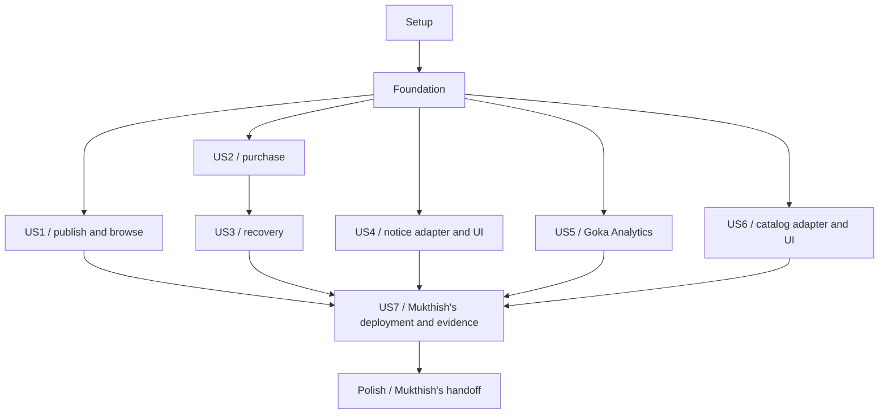

# Tasks: Flash Sale Platform — Mukthish

**Input**: [plan.md](plan.md), [spec.md](spec.md), [research.md](research.md),
[data-model.md](data-model.md), [contracts](contracts/README.md) and [quickstart.md](quickstart.md)
from `specs/001-flash-sale-platform/`.

**Prerequisites**: Completed Phase 1 design and Constitution v1.0.0; generation date 2026-10-25.
**Scope**: Only your Admission, Flash Sale Manager, Order, Sales Analytics, frontend, gateway,
Message Queue, and your integration/HPA/load evidence. Go 1.27.3, Goka v1.1.17 and IBM Sarama
v1.46.3 apply to your code. Kafka remains the broker. Teammate stacks remain their choice.
**Tests**: Included because FR-035 and Constitution III/IV explicitly require automated behavior,
contract, concurrency, failure and recovery verification. Write story checks before implementing
the behavior and demonstrate the intended failure, then make them pass. Documentation-only changes
receive path/command/consistency checks rather than redundant test suites.
**Organization**: Keep all seven original story IDs for traceability, with only your slice of US4,
US6 and US7. Every checkbox belongs to you; the external-deliverable table is not a teammate task list.

## Format: `[ID] [P?] [Story] Description`

- Each task starts with an unchecked box and sequential T ID; story phases carry US1–US7.
- `[P]` means the listed sibling tasks can run together after their named prerequisites and the
  phase gate are satisfied; it does not permit skipping prerequisites or concurrent file conflicts.
- `after T...` records task dependencies; phase gates and the story graph also apply.
- An `E1`/`E2`/`E3` requirement blocks only the real external acceptance run, not your independent
  fixture-based development. An unavailable run stays unchecked/unverified; a double never proves
  a real service's guarantee. A recorded report with missing evidence does not satisfy that task.
- Source constraints are quoted in relevant task descriptions; current schemas supply all remaining
  required/optional fields, lengths, numeric bounds and enums. Do not reinterpret them during coding.

## Path Conventions

All code paths are repository-relative future artifacts. Your roots are `services/admission/`,
`services/flash-sale/`, `services/order/`, `services/analytics/`, `frontend/`, `gateway/`, and the
shared contract, helper, local-dependency, messaging and test paths explicitly named below.
No task implements `services/inventory/`, `services/payment/`, `services/catalog/`,
`services/notification/`, `storage/catalog-kv/` or the shared `infra/` platform.

Your doubles under `tests/doubles/` implement only controlled contract responses for testing;
they are not alternate production peer services. Provider-specific cloud resource creation,
serverless implementation, replica storage/repair, shared monitoring/log infrastructure and peers'
unit frameworks stay outside this list. Your application desired state and metrics are integration
inputs to their owners. No source, runtime or deployment is created by generating this task file.

| External dependency | Existing owner / required interface | Where it matters |
| --- | --- | --- |
| E1 | Member 2: live Inventory RPCs, Payment/refund events and read-only/fault verification adapter | Real purchase, no-oversell, expiry/compensation and load evidence |
| E2 | Member 3: live Catalog/leaderless failure adapter and serverless Notification query/event adapter | Actual browsing/readiness, notices and concept recovery evidence |
| E3 | Member 2/platform: managed cluster, broker hosting connectivity, metrics/headroom, HTTPS, identities and GitOps entry point | Your broker configuration, application release, HPA and live evidence |
| E4 | Affected producer/consumer reviewers: recorded contract compatibility review | Shared/breaking contract merge gate; no approval is implied |

These are handoff interfaces only. Roles come from the agreed ownership baseline; no teammate
implementation work or technology choice is assigned by this document.

## Phase 1: Setup (Shared Infrastructure)

**Goal**: Initialize only Mukthish's workspace, local dependencies, reviewed contracts and repeatable commands.

**Independent Test**: Each of Mukthish's modules builds its empty entry point; local PostgreSQL/Kafka are healthy; contract checks run without any teammate source.

- [ ] T001 Create your Go module layout and Go 1.27.3 workspace in `go.work`, `services/admission/go.mod`, `services/flash-sale/go.mod`, `services/order/go.mod`, `services/analytics/go.mod`, `gateway/go.mod`, `frontend/go.mod`, `internal/platform/go.mod`, `contracts/go.mod` and `tests/go.mod`; use the existing `flash-sale` contract import prefix and exclude teammate source modules.
- [ ] T002 Pin Goka v1.1.17, IBM Sarama v1.46.3, pgx v5, grpc-go/protobuf and the selected JWT/test/metric tooling in your `go.work.sum` and Mukthish's `go.mod`/`go.sum` files; use one Sarama version through Goka and direct clients and retain tool checksums in `dev/tool-versions.json`. (after T001)
- [ ] T003 Promote the seven reviewed files from the feature `contracts/` directory to root `contracts/`, preserving the language-neutral source and generating only your Go bindings under `contracts/gen/`; implement schema/example/protobuf and source-drift checks in `scripts/validate_contracts.py` and `contracts/generate.go`. (after T002)
- [ ] T004 [P] Define your PostgreSQL 17 databases and Kafka KRaft dependency with pinned images, health checks, separate named volumes and run-isolated settings in `dev/compose.yaml` and `dev/postgres/init.sql`; include adapter hooks without selecting or implementing teammate runtimes. (after T003)
- [ ] T005 [P] Create documented non-secret configuration and disposable local-key/token locations in `dev/lead.env.example` and `.gitignore`; define separate Flash Sale, Admission and Order credentials, peer endpoint inputs and fail-closed configuration validation without committed credentials. (after T003)
- [ ] T006 [P] Create Mukthish's format/lint/compiler/race-test and contract-check commands in `Makefile`, `ci/lead-checks.sh` and `staticcheck.conf`; enumerate your modules rather than assuming workspace-root `go test ./...` covers them, and make unimplemented application targets fail clearly. (after T003)
- [ ] T007 [P] Record only your four service assignments and frontend/gateway/Message Queue plus categories (c)/(e) responsibilities in `task_divison.txt`; document peer deliverables as external interfaces in `docs/lead-boundaries.md` without assigning their implementation stack or tasks. (after T003)
- [ ] T008 Add configuration-driven startup and graceful shutdown skeletons in `services/admission/cmd/server/main.go`, `services/flash-sale/cmd/server/main.go`, `services/order/cmd/server/main.go`, `services/analytics/cmd/server/main.go` and `gateway/cmd/server/main.go`, and an embedded asset package in `frontend/embed.go`. (after T004, T005, T006, T007)

**Checkpoint**: Your workspace and tool commands exist; no teammate application source has been created.

---

## Phase 2: Foundational (Blocking Prerequisites)

**Goal**: Provide Mukthish's primitives and test seams required by every story. Complete this phase before story implementation.

**Independent Test**: Run foundation tests against real local SQL/Kafka and contract doubles; prove rollback, repeat handling, identity filtering and offset ordering.

- [ ] T009 [P] Implement shared value validation with boundary tests in `internal/platform/value/value.go` and `internal/platform/value/value_test.go`; quote-preserve "IDs are UUID strings", "UTC RFC 3339", "between 0 and 9,007,199,254,740,991", "Sale unit prices are positive.", "Quantity is an integer from 1 to 100 in this release", "No cross-currency addition is permitted." and "Request keys are 1-128 printable ASCII characters."; enforce currency `^[A-Z]{3}$`, overflow checks and required/optional fields from the reviewed schemas. (after T008)
- [ ] T010 [P] Implement your JWT verifier and service-context authentication in `internal/platform/auth/auth.go` with role/expiry/forged-header tests in `internal/platform/auth/auth_test.go`; enforce "role: SHOPPER|OPERATOR", "15-minute JWTs signed with a generated RSA key", issuer/audience/expiry and authenticated service subjects; never add a public token-minting route. (after T008)
- [ ] T011 [P] Provide controlled UTC time, UUID/correlation generation and failpoint interfaces in `internal/platform/clock/clock.go` and `internal/platform/fault/fault.go`; deterministic tests must advance conditions explicitly rather than use arbitrary sleeps. (after T008)
- [ ] T012 Implement your shared JSON error/validation middleware and route registration primitives in `internal/platform/httpapi/http.go`; preserve schema error enums, optional `retry_after_seconds`/`current_offer`, HTTP 400/401/403/404/409/429/503 and correlation IDs, and support a remaining request deadline rather than stacking timeouts. (after T009, T010, T011)
- [ ] T013 Implement your transactional migration runner and per-owner connection pools in `internal/platform/postgres/migrate.go` and `internal/platform/postgres/pool.go`; track applied checksums and roll back failed migrations without cross-service database writes. (after T012)
- [ ] T014 Implement your envelope codec and typed event bindings in `internal/platform/events/envelope.go`; preserve "schema_version=1", UUID IDs, UTC times, owner/entity aggregate versions and producer/topic rules; producer payloads match current schemas while known-major consumers tolerate harmless optional additions and quarantine unknown kinds/majors. (after T003, T009)
- [ ] T015 Implement your checked Sarama producer/consumer builders in `internal/platform/messaging/sarama.go` with real-Kafka tests in `tests/integration/sarama_delivery_test.go`; enforce `Producer.RequiredAcks=WaitForAll`, `Producer.Idempotent=true`, `Net.MaxOpenRequests=1`, returned successes/errors and offset acknowledgement only after durable handler completion. (after T014, T004)
- [ ] T016 Implement reusable inbox/outbox/destination-receipt storage and crash tests in `internal/platform/eventstore/store.go`, `internal/platform/eventstore/schema.sql` and `tests/integration/outbox_recovery_test.go`; enforce unique "consumer_name, event_id", separate domain/analytics receipts and retention until both destinations acknowledge, with business change/inbox/outbox in one owner transaction. (after T013, T015)
- [ ] T017 Implement retry scheduling, inspectable quarantine and authorized audited replay for your consumers in `internal/platform/messaging/retry.go` and `scripts/cmd/replay/main.go`; retain original identity/payload/topic/partition/offset and use "five delayed retries at 1/2/4/8/16 seconds", pausing dependency-wide outages while preserving business obligations. (after T016)
- [ ] T018 Create contract-limited Inventory gRPC, Payment event, Catalog REST and Notification query doubles under `tests/doubles/` with entry point `tests/doubles/cmd/server/main.go`; expose controlled outcomes/timeouts/faults for your tests only and make fixture-mode evidence visibly different from real-service acceptance. (after T003, T010, T011, T015)
- [ ] T019 Define URL/credential inputs, start/health/fault/read-only-verification adapter commands and explicit unavailable-dependency results in `tests/adapters/contract.go`, `dev/adapters.example.json` and `docs/peer-adapter-contract.md`; do not inspect or migrate teammate databases directly. (after T018)
- [ ] T020 Implement Mukthish's lifecycle/health/readiness hooks, structured log correlation and metric registration in `internal/platform/runtime/runtime.go` and `internal/platform/telemetry/telemetry.go`; wire your entry points, identity/adapter fixture seeding and condition-based `make bootstrap dev-up migrate seed wait-ready` commands through `scripts/cmd/dev/main.go` and `Makefile`; add business-fixture seeding in its owning story phase. (after T017, T019)

**Checkpoint**: Foundation ready. Story work may begin; peer service doubles are test boundaries, not accepted implementations.

---

## Phase 3: User Story 1 - Publish a sale and browse its products (Priority: P1) — MVP

**Goal**: Implement your Flash Sale configuration/readiness, Admission configuration projection, gateway browsing and operator/storefront UI.

**Independent Test**: With a Catalog double and seeded readiness acknowledgements, publish a 100-unit sale, withhold one acknowledgement, advance start/end time and verify availability, freeze and cancellation rules.

### Tests for User Story 1

- [ ] T021 [P] [US1] Write failing public/internal sale and Catalog-proxy contract tests in `tests/contract/us1_sale_routes_test.go`; cover operator denial, required SaleWrite fields, version conflicts, stale readiness and start-inclusive/end-exclusive eligibility (FR-001–FR-004, SC-001/SC-014).
- [ ] T022 [P] [US1] Write failing readiness/activation interruption tests in `tests/integration/us1_readiness_test.go` using real SQL/Kafka and Catalog/Inventory acknowledgement doubles; test duplicate/obsolete versions, cancellation, missing participants and activation replay.

### Implementation for User Story 1

- [ ] T023 [US1] Model configuration/readiness in `services/flash-sale/internal/sale/model.go` and `services/flash-sale/migrations/001_sales.sql`; preserve "cancelled_at?, frozen_at?", unique "(sale_id, version, participant)", participant values "Catalog, Admission, or Inventory", positive allocation/price, "starts_at < ends_at" and all SaleWrite bounds/required fields; use `expected_version=0` for create and current version for replacement/cancel. (after T021, T022)
- [ ] T024 [US1] Model Admission applied sale/version/activation projection in `services/admission/internal/sale/model.go` and `services/admission/migrations/001_sales.sql`; use the documented effective statuses and the rule "Once the original start time is reached, price/allocation/window replacement is rejected" without storing another service's authoritative state. (after T023)
- [ ] T025 [US1] Implement durable readiness consumption and the activation/schedule worker in `services/flash-sale/internal/sale/readiness.go`; only matching Catalog/Admission/Inventory version+allocation digest can activate, and persist SaleActivated plus its outbox before dispatch; re-evaluate end time on restart. (after T024)
- [ ] T026 [US1] Implement authorized sale create/replace/cancel, public/internal authoritative offer and their schema errors in `services/flash-sale/internal/http/sales.go`; freeze the original start boundary, reject path/body-ID mismatch and preserve the SaleConfigured/SaleCancelled outbox in the same transaction. (after T025)
- [ ] T027 [US1] Implement your SaleConfigured/SaleActivated/SaleCancelled consumer and SaleReady publication in `services/admission/internal/sale/consumer.go`; buffer/reconcile early activation, ignore obsolete versions and retain schedule checks after activation. (after T026)
- [ ] T028 [US1] Implement your explicit sale/Catalog browsing routes in `gateway/internal/routes/sales.go` and Catalog client in `gateway/internal/catalog/client.go`; preserve public schema errors and unavailable/conflicting metadata without choosing Catalog storage or deriving authoritative charges from its display offer. (after T027)
- [ ] T029 [US1] Implement your operator sale form/readiness display and shopper product/offer views in `frontend/templates/sales.html`, `frontend/templates/products.html` and `frontend/assets/sales.js`; enforce the same constraints, role gates and UPCOMING/ACTIVE/ENDED/UNAVAILABLE/CANCELLED display states. (after T028)
- [ ] T030 [US1] Wire `sale-readiness` and isolated live schedule seeding in `tests/scenarios/us1_sale.go`; run the red tests and browser checks to green, record fixture-only evidence in `docs/evidence/us1.md`, and support E2 when Catalog's real adapter becomes available. (after T029)

**Checkpoint**: Your US1 slice is independently demonstrable. Actual Catalog readiness/browsing remains an E2 integration gate.

---

## Phase 4: User Story 2 - Purchase scarce stock without overselling (Priority: P1)

**Goal**: Implement your shared Admission limits and Order happy path, request identity, Inventory client and purchase/status UI.

**Independent Test**: Use seeded live-sale fixtures without US1 UI, real SQL/Kafka for Mukthish's services and contract doubles; compete for 100 units, replay one key concurrently, then confirm through Payment results and retrieve only the shopper's Order.

### Tests for User Story 2

- [ ] T031 [P] [US2] Write failing purchase, authoritative-offer and Inventory-client contract tests in `tests/contract/us2_purchase_test.go`; cover 202 pending/200 terminal replay, changed offer, malformed/mismatched key payload, 409 REQUEST_IN_PROGRESS and owner-filtered 404.
- [ ] T032 [P] [US2] Write failing multi-instance quota/lease tests in `tests/integration/us2_admission_test.go`; verify shared rate/in-flight ceilings, expiry after crash, explicit 429 Retry-After and fail-closed 503 on unavailable SQL.
- [ ] T033 [P] [US2] Write failing concurrent reservation/request tests in `tests/integration/us2_idempotency_test.go`; send 50 simultaneous matching requests, verify one intent/order/reservation/payment request and reject changed quantity/offer fields under the same shopper key.

### Implementation for User Story 2

- [ ] T034 [US2] Model quota/lease/attempt records in `services/admission/internal/quota/model.go` and `services/admission/migrations/002_quotas.sql`; quote-preserve "scope: SALE|SHOPPER_SALE", "retry_after_seconds?", "released_at?" and defaults "5 attempts/shopper/second, 100 attempts/sale/second, and 50 concurrent" forwards with a "two-second lease lifetime". (after T031, T032, T033)
- [ ] T035 [US2] Implement deterministic lock-order quota acquisition and repeat-safe lease release/reclamation in `services/admission/internal/quota/limiter.go`; share one database across replicas, use configured sale limits and never claim admission guarantees stock. (after T034)
- [ ] T036 [US2] Model PurchaseIntent, Order and saga progress in `services/order/internal/order/model.go` and `services/order/migrations/001_orders.sql`; preserve "state: RECEIVED|RESERVING|ACCEPTED|REJECTED", "reservation_id?, rejection_code?, response_snapshot?", "lease_owner?, lease_until?", "refund_id?", unique "(shopper_id, request_key)" and public states "PENDING_PAYMENT, CONFIRMED, FAILED, EXPIRED" with all reviewed Order required fields/bounds. (after T035)
- [ ] T037 [US2] Implement durable request-key claim/replay and canonical payload hashing in `services/order/internal/order/intent_store.go`; include shopper, sale, product, quantity, expected offer version/unit price/currency, retain keys for the dataset lifetime, allocate a stable proposed Order UUID before Inventory and fence stale workers. (after T036)
- [ ] T038 [US2] Implement only your Order-side Inventory Reserve/GetReservation/Confirm/Release client in `services/order/internal/inventory/client.go`; preserve stable Order/reservation IDs, remaining deadlines and all ResultCode/transport-error distinctions without implementing Inventory transitions. (after T037)
- [ ] T039 [US2] Implement acceptance and authoritative-offer checks in `services/order/internal/order/accept.go`; compare the expected offer, reserve first, then atomically persist pending Order+PaymentRequested; never request payment on a rejected purchase or invent acceptance after an ambiguous reservation. (after T038)
- [ ] T040 [US2] Implement your purchase handler/Order forwarding in `services/admission/internal/http/purchase.go`; generate one attempt ID per external submission, preserve it on transport retries, use the 1.5-second forwarding budget, record AttemptRecorded+latency before response and release the in-flight lease. (after T039)
- [ ] T041 [US2] Implement your successful Payment result consumer in `services/order/internal/order/payment_success.go`; inbox-deduplicate the stable attempt, confirm/query Inventory before CONFIRMED, emit OrderConfirmed atomically and preserve payment identity across retries. (after T040)
- [ ] T042 [US2] Implement Admission-only internal Order POST and subject-filtered public Order GET in `services/order/internal/http/orders.go`; return expiry/Location/attempt identity as contracted, map permanent rejections to recorded replay and keep temporary dependency failures retryable. (after T041)
- [ ] T043 [US2] Expose only the approved purchase/status routes in `gateway/internal/routes/purchases.go`; strip forged internal identity headers, preserve Idempotency-Key/correlation IDs and prevent public access to Inventory or Payment operations. (after T042)
- [ ] T044 [US2] Implement your checkout/offer reconfirmation, stable-key retry and order polling UI in `frontend/templates/checkout.html` and `frontend/assets/purchase.js`; tokens remain in memory, corrected offers require a new explicit purchase and terminal replay never creates another order. (after T043)
- [ ] T045 [US2] Implement `purchase-success` and the accepted-key portion of `duplicate-replay` in `tests/scenarios/us2_purchase.go`; reconcile every observed stock transition through the verification adapter and record fixture results in `docs/evidence/us2.md`, then rerun against E1 before claiming live no-oversell/settlement acceptance. (after T044)

**Checkpoint**: Your purchase slice passes with doubles; real Inventory/Payment (E1) are required for SC-002/SC-004/SC-005 acceptance.

---

## Phase 5: User Story 3 - Resolve failures, expiry, and late payment (Priority: P1)

**Goal**: Finish your Order reconciliation, failure/expiry handling, refund obligations and recovery controls; Inventory expiry and Payment/refund execution remain external.

**Independent Test**: Inject lost responses and process interruption at all eight documented boundaries; verify a lost successful Confirm is recovered, while expired/released paid holds yield one durable refund obligation.

### Tests for User Story 3

- [ ] T046 [P] [US3] Write failing Order-side confirmation/expiry/release ordering tests in `tests/integration/us3_terminal_races_test.go`; include delayed successful Confirm responses, expiry at the exact boundary, duplicate/contradictory Payment results and no terminal-state regression.
- [ ] T047 [P] [US3] Write failing interruption/reconciliation tests in `tests/integration/us3_recovery_test.go` for all eight rows of the data-model recovery table, observing peer state only through the controlled adapter and preserving original operation identities.
- [ ] T048 [P] [US3] Write failing durable refund/quarantine tests in `tests/integration/us3_refund_retry_test.go`; require one RefundRequested/RefundPending, repeat-safe RefundCompleted handling, retained obligations after retry exhaustion and unrelated-key progress.

### Implementation for User Story 3

- [ ] T049 [US3] Implement leased one-second intent/saga reconciliation in `services/order/internal/order/reconcile.go`; query Inventory by stable Order ID, create pending work only from a live hold, resume outboxes and recover successful confirmation before any compensation. (after T046, T047, T048, T045)
- [ ] T050 [US3] Implement your PaymentFailed and ReservationExpired consumers in `services/order/internal/order/failure.go`; map RELEASED to FAILED and EXPIRED to EXPIRED only from authoritative Inventory state, keep unreachable transitions pending/reconciling and never operate Inventory's expiry worker. (after T049)
- [ ] T051 [US3] Persist your unique payment-attempt refund obligation/status in `services/order/migrations/002_refunds.sql` and `services/order/internal/order/compensate.go`; expose "PENDING|COMPLETED|REPAIR_REQUIRED", retain "last_error?", emit RefundRequested+RefundPending atomically and consume RefundCompleted without executing the refund yourself. (after T050)
- [ ] T052 [US3] Enforce aggregate-version fencing, stable attempt/result checks and no terminal Order reopening in `services/order/internal/order/transitions.go`; quarantine contradictory fabricated results and preserve one business effect under duplicate or out-of-order deliveries. (after T051)
- [ ] T053 [US3] Wire your recovery failpoints and replay/introspection controls in `services/order/internal/order/recovery_controls.go`; keep fixture-only controls off public routes and route retry exhaustion through the durable failed-work store without erasing accepted orders/refund obligations. (after T052)
- [ ] T054 [US3] Add shopper-visible failed/expired/reconciling/refund-pending/completed states in `frontend/templates/order.html` and `frontend/assets/order-status.js`; do not display an uncertain Inventory timeout as a definitive failure or confirmation. (after T053)
- [ ] T055 [US3] Implement `payment-failure`, `expiry-race`, `late-payment`, `crash-recovery` and `poison-record` in `tests/scenarios/us3_recovery.go`; produce order/refund identity and stock-ledger assertions with controlled time, including 120-second expiry, <=10-second reclamation and <=30-second refund-after-recovery checks when E1 is live. (after T054)
- [ ] T056 [US3] Run your recovery scenarios through E1 and record results or explicit blocked/unverified cases in `docs/evidence/us3.md`; confirm recovery <=60 seconds after dependencies return and never substitute double behavior for Inventory/Payment acceptance. (after T055; live dependency E1)

**Checkpoint**: Your Order recovery code is complete; E1 owns actual expiry/charge/refund effects and supplies the live evidence boundary.

---

## Phase 6: User Story 4 - See purchase outcome notifications (Priority: P2)

**Goal**: Implement your authenticated Notification gateway adapter, outcome-publishing compatibility and shopper notification UI only.

**Independent Test**: With a seeded Notification adapter, test subject filtering, notices/refund states and temporary unavailability while seeded purchase processing continues; later verify against the real serverless adapter.

### Tests for User Story 4

- [ ] T057 [P] [US4] Write failing Notification-query proxy/access tests in `tests/contract/us4_notifications_test.go`; use reviewed notice/page shapes, pagination, forged subject rejection and another shopper's inaccessible records.
- [ ] T058 [P] [US4] Write failing producer-side notice-trigger event tests in `tests/contract/us4_notice_events_test.go`; validate OrderConfirmed/Failed/Expired and RefundPending, stable correlation/Order IDs and duplicate replay without implementing notice persistence or delivery.

### Implementation for User Story 4

- [ ] T059 [US4] Implement your authenticated peer query adapter in `gateway/internal/notification/client.go` and route in `gateway/internal/routes/notifications.go`; forward only verified subject/limit/cursor, preserve delivery-state fields and fail independently of purchase processing. (after T057, T058)
- [ ] T060 [US4] Implement notification pagination/outcome/refund UI in `frontend/templates/notifications.html` and `frontend/assets/notifications.js`; preserve "CONFIRMED, FAILED, EXPIRED, REFUND_PENDING, or REFUND_COMPLETED", "PENDING|DELIVERED|REPAIR_REQUIRED", "reservation_id?" and optional delivery/error fields from the read model without creating your own notice store. (after T059)
- [ ] T061 [US4] Implement your fixture portion of `notice-recovery` in `tests/scenarios/us4_notifications.go`; check UI/proxy behavior during unavailable delivery and stable Order/event correlation, and document which canonical notice/dedup assertions require the peer implementation. (after T060)
- [ ] T062 [US4] Run your adapter/UI with the E2 serverless Notification service and record one logical notice, expiry-event coalescing and p95 <=10-second visibility evidence in `docs/evidence/us4.md`; leave unverified if that service is unavailable. (after T061; live dependency E2)

**Checkpoint**: Your notification consumer-facing slice is complete; Notification backend/retries/storage remain Member 3's work.

---

## Phase 7: User Story 5 - Understand demand and sales as they happen (Priority: P2)

**Goal**: Implement your Goka Analytics processor, persistent group state, durable-state View/relay, Flash Sale results projection and operator view.

**Independent Test**: Replay a golden timestamped dataset with duplicates, empty windows, late arrivals and all state/output/offset crash orderings; rebuild an empty cache and rebalance partitions without changing final totals.

### Tests for User Story 5

- [ ] T063 [P] [US5] Write failing Goka-tester aggregation/window tests in `services/analytics/internal/window/processor_test.go`; cover event-time windows, exact seen-ID semantics, mixed currencies, zero-activity windows, broker arrival at cutoff and historical FINAL freshness.
- [ ] T064 [P] [US5] Write failing real-Kafka state/View/relay/rebalance tests in `tests/integration/us5_goka_recovery_test.go`; kill before/after state persist, output publication and offset advancement, then restore from an empty cache and verify stable output identities.
- [ ] T065 [P] [US5] Write failing WindowSummary/late-result contract and projection tests in `tests/contract/us5_results_test.go`; require higher-revision replacement, FINAL never reverting, late counts separate and no extra attempt/order/revenue contribution from duplicate envelopes.

### Implementation for User Story 5

- [ ] T066 [US5] Define the versioned Goka state codec in `services/analytics/internal/window/state.go`; preserve "state_schema_version", "seen_event_ids, seen_attempt_ids, seen_order_ids, distinct_shopper_ids", "late_outputs, last_input_offset", "status: PROVISIONAL|FINAL", nonnegative metrics and "[50,100,250,500,1000,2000,5000]" plus overflow bins; derive required/optional fields from WindowSummary and retain dedup/finalization "at least eight days". (after T063, T064, T065)
- [ ] T067 [US5] Implement the shared sale/product/window key and Goka-compatible Sarama partitioner with golden-key tests in `services/analytics/internal/stream/partition.go` and `tests/contract/analytics_partition_test.go`; enforce "six partitions and a shared hash", raw LogAppendTime and compact-only group state, rejecting incompatible topic/hash settings. (after T066)
- [ ] T068 [US5] Implement your state-only Goka processor in `services/analytics/internal/window/processor.go`; select UTC minute windows by occurrence time, deduplicate event/attempt/order IDs, count only their prescribed event kinds, separate currency revenue and bound serialized per-window state against broker record limits. (after T067)
- [ ] T069 [US5] Implement Analytics-only `GET /internal/analytics/windows` in `services/flash-sale/internal/http/analytics_windows.go`; require `from`/`through`, return known sale/product windows including empty ones and validate bounded intervals without depending on US1's UI. (after T068)
- [ ] T070 [US5] Implement your schedule-driven heartbeat emitter in `services/analytics/internal/clock/emitter.go`; emit per unfinished window every second with the same key/hash, use recorded broker append time and "window_end + 60 seconds" cutoff, and withhold fresh-report claims on schedule/broker lag. (after T069)
- [ ] T071 [US5] Implement recovered Goka View and Sarama output relay in `services/analytics/internal/results/relay.go`; publish only durable stored revisions with deterministic "(summary_id, revision)" identities, retry/rescan every second and on startup, and never emit results directly from an uncommitted processing callback. (after T070)
- [ ] T072 [US5] Implement finalization guards, audited original-ingestion metadata and repeat-safe late-output retention in `services/analytics/internal/window/late.go`; input at/after cutoff or unseen repaired input after FINAL must not reopen totals, and duplicate late events retain original identity. (after T071)
- [ ] T073 [US5] Model your Flash Sale AnalyticsProjection and LateActivity in `services/flash-sale/migrations/002_analytics.sql` and `services/flash-sale/internal/analytics/model.go`; preserve unique "original_event_id", "revision", "status: PROVISIONAL|FINAL" and optional query filters, with FINAL immutable to provisional replacement and no cross-currency sums. (after T072)
- [ ] T074 [US5] Implement your results/late-topic consumers and operator analytics endpoint in `services/flash-sale/internal/analytics/consumer.go` and `services/flash-sale/internal/http/analytics.go`; atomically upsert only higher revisions, deduplicate late counts and show delayed based on expected work rather than an old historical FINAL timestamp. (after T073)
- [ ] T075 [US5] Implement your authenticated Analytics gateway route and operator view in `gateway/internal/routes/analytics.go`, `frontend/templates/analytics.html` and `frontend/assets/analytics.js`; expose counts/rates/reasons, currency totals, histogram precision and PROVISIONAL/FINAL/delayed indicators. (after T074)
- [ ] T076 [US5] Wire your Goka group, View, relay, clock and health/shutdown in `services/analytics/internal/app/app.go` and `services/analytics/cmd/server/main.go`; readiness waits for state/View recovery, missing dependencies report delayed, and graceful shutdown does not advance offsets ahead of durable state. (after T075)
- [ ] T077 [US5] Implement `analytics-replay` and its hand-calculated multi-product/currency dataset in `tests/scenarios/us5_analytics.go` and `tests/fixtures/analytics/golden.json`; assert exact final counts, empty windows, latency bins, zero duplicate contribution and final visibility <=5 seconds after cutoff under the declared healthy workload. (after T076)
- [ ] T078 [US5] Run your golden, interruption, empty-cache and rebalance suites, then consume actual peer Inventory/Payment activity when E1 is available; record independent fixture/Kafka results and separately verified live event compatibility in `docs/evidence/us5.md`. (after T077)

**Checkpoint**: Your Analytics slice is independently verifiable with golden events; live producer compatibility remains an E1/E2 boundary check.

---

## Phase 8: User Story 6 - Browse replicated catalog metadata through failures (Priority: P2)

**Goal**: Implement only your Catalog gateway/frontend concept demonstration and owner-interface checks; do not implement replicas, vector clocks or repair.

**Independent Test**: Use Catalog responses for healthy/conflicting/unavailable metadata and admin inspection; verify your UI preserves contexts and an accepted Order snapshot is unaffected by metadata failures.

### Tests for User Story 6

- [ ] T079 [P] [US6] Write failing Catalog proxy/metadata-write contract tests in `tests/contract/us6_catalog_proxy_test.go`; preserve quorum-unavailable vs absence vs conflict, operator authorization and the complete version/context payload without adding local winner selection.
- [ ] T080 [P] [US6] Write failing operator context/conflict and purchase-isolation journey tests in `tests/e2e/us6_catalog_test.go`; use scripted Catalog states, verify admin-only inspection and require explicit user resolution rather than silent last-writer-wins.

### Implementation for User Story 6

- [ ] T081 [US6] Implement your version-inspection, metadata-write and replica-health forwarding in `gateway/internal/routes/catalog_admin.go`; preserve operation ID/context/sibling shapes, all required fields and schema bounds `"maxLength": 200`, `"maxLength": 10000`, `"maxItems": 10` without implementing the coordinator/replica protocol. (after T079, T080)
- [ ] T082 [US6] Implement your operator concept panel in `frontend/templates/catalog-demo.html` and `frontend/assets/catalog-demo.js`; render N=3/R=2/W=2, node health, preserved contexts/siblings and explicit resolution, while ordinary product conflicts/unavailability stay visible and accepted checkout uses its authoritative snapshot. (after T081)
- [ ] T083 [US6] Implement the consumer/UI portions of `catalog-quorum` and `catalog-conflict-repair` in `tests/scenarios/us6_catalog.go`; assert response/display behavior with scripted peer states and leave actual replica-stop, durable-restart and repair operations to the E2 adapter. (after T082)
- [ ] T084 [US6] Connect your concept panel/scenarios to E2 and capture owner-supplied one-node/two-node failure, concurrent-version resolution and <=60-second recovery evidence in `docs/evidence/us6.md`; mark your adapter checks separately from Member 3's storage acceptance. (after T083; live dependency E2)

**Checkpoint**: Your concept UI/adapters are complete; leaderless storage implementation and its recovery guarantee remain external.

---

## Phase 9: User Story 7 - Operate, scale, and demonstrate the complete system (Priority: P2)

**Goal**: Deliver your application packaging, Kafka configuration, HPA/load work and observability/release integration without implementing the shared platform.

**Independent Test**: On local dependencies verify your routes, metrics and recoverable release behavior; on E3 capture real scale-out of Admission and Order plus evidence for your categories (c)/(e).

### Tests for User Story 7

- [ ] T085 [US7] Write your opt-in live access/deadline/draining/revision scenarios in `tests/platform/us7_runtime_test.go`; record absent platform/peer inputs as blocked/unverified, and test that live public traffic cannot invoke internal stock/payment routes or forge another shopper/operator.

### Implementation for User Story 7

- [ ] T086 [US7] Create pinned multi-stage images for your services in `services/admission/Dockerfile`, `services/flash-sale/Dockerfile`, `services/order/Dockerfile`, `services/analytics/Dockerfile` and `gateway/Dockerfile`; embed your frontend assets and expose health/revision without adding teammate container images. (after T085)
- [ ] T087 [US7] Create application-only desired state for your containers in `deploy/lead/apps/admission.yaml`, `deploy/lead/apps/flash-sale.yaml`, `deploy/lead/apps/order.yaml`, `deploy/lead/apps/analytics.yaml` and `deploy/lead/apps/gateway.yaml`; use provided cluster identities/secrets/endpoints, graceful draining and state-recovery readiness, leaving cluster/IaC/network/serverless resources to E3. (after T086)
- [ ] T088 [US7] Define your Admission/Order HPA and resource settings in `deploy/lead/autoscaling/admission.yaml` and `deploy/lead/autoscaling/order.yaml`; preserve min=1/max=6, CPU target 60%, requests 100m/128Mi, limits 1CPU/512Mi and 30s/300s stabilization, requiring platform metrics/headroom before claiming scaling. (after T087)
- [ ] T089 [US7] Implement your idempotent Kafka topic bootstrap/verify command and desired broker/topic settings in `scripts/cmd/topics/main.go` and `deploy/messaging/topics.json`; include every reviewed domain/retry/results/late topic, six-partition Goka co-partitioning, seven-day raw retention, LogAppendTime and compact-only state, coordinated against the supplied E3 broker endpoint without choosing teammate tooling. (after T088)
- [ ] T090 [US7] Complete your per-service and Goka instrumentation, scrape requirements and dashboard panels in `deploy/lead/observability/metrics-contract.md` and `deploy/lead/observability/dashboard.json`; expose rates, errors/latency, quota/stock workflow, outbox/consumer/View lag and pending refunds, using bounded labels and correlation IDs while E3 owns the shared monitoring/logging platform. (after T089)
- [ ] T091 [US7] Implement distinct reproducible correctness/scaling k6 profiles in `tests/load/correctness.js`, `tests/load/scaling.js` and versioned settings in `tests/load/profiles.json`; correctness uses 100 units, >=10,000 attempts/10 minutes and >=50 shoppers, while scaling uses ample preallocated stock/raised limits and real purchase-path demand without fake CPU work. (after T090)
- [ ] T092 [US7] Run your access checks and both load profiles on E3 with E1, recording p50/p95/p99, expected rejections vs <1% unexpected errors, per-transition stock invariants and ready-pod timelines for both HPAs in `docs/evidence/us7-load.md`; require p95 response <=2s, overload <=1s and actual scale-out within ten minutes. (after T091; live dependency E1, E3)
- [ ] T093 [US7] Exercise your reviewed immutable revision rollback and Goka cache/partition recovery on E3, using platform-owner reconciliation rather than direct `kubectl apply`; record retained orders/reservations, public revision and stable final summaries in `docs/evidence/us7-release.md`. (after T092; live dependency E3)
- [ ] T094 [US7] Complete your documented Make/demo/load/evidence command dispatch in `Makefile` and `scripts/cmd/demo/main.go`; accept peer/platform adapters as inputs, separate deterministic local from live results and preserve run-isolated cleanup rather than destructive global resets. (after T093)
- [ ] T095 [US7] Prepare your individual (c)/(e), Message Queue/frontend/gateway demonstration and platform integration checklist in `docs/lead-demo.md`; link your reports, broker/state recovery and HPA evidence while naming externally supplied platform/storage/notification evidence without claiming ownership or completion. (after T094)

**Checkpoint**: Your deployable artifacts/load work are complete; live demonstration requires E1/E3 and separately available peer evidence.

---

## Phase 10: Polish & Cross-Cutting Concerns

**Goal**: Finish your maintenance handoff and verify the scoped work without broadening ownership.

**Independent Test**: Mukthish's command suite and real available adapter scenarios produce traceable evidence; unavailable shared pieces remain explicit.

- [ ] T096 [P] Document purpose, owner, configuration, start/test, recovery and rollback for your components in `services/admission/README.md`, `services/flash-sale/README.md`, `services/order/README.md`, `services/analytics/README.md`, `gateway/README.md` and `frontend/README.md`; update the feature `quickstart.md` only to reflect implemented commands/adapters for Mukthish. (after T095)
- [ ] T097 [P] Prepare the exact producer/consumer contract change packet and record obtained reviews in `docs/contract-review.md`; preserve member-owned implementation choices, distinguish pending review from approval and require E4 before merging a breaking/shared-boundary change. (after T095)
- [ ] T098 Run your required format/lint/compiler/contracts/unit/integration/race/end-to-end checks after implementation and record commands, results and limitations in `docs/evidence/lead-validation.md`; regressions require a reproducing check and no missing live run may be reported passed. (after T096, T097)
- [ ] T099 Update Mukthish's acceptance/ownership traceability in `docs/lead-traceability.md` and `task_divison.txt`; map implemented tasks to FR/SC evidence and leave Inventory/Payment/Notification/replica/platform obligations explicitly outside this checklist. (after T098)
- [ ] T100 Run the implemented quickstart for Mukthish and prepare the final reviewable handoff in `docs/lead-handoff.md`; include revisions, contract versions, run IDs, pending external dependencies/reviews and retained data/evidence, without deploying paid resources or marking the whole eight-service project complete. (after T099)

**Checkpoint**: All of Mukthish's tasks have evidence or an explicit external blocker; this checklist never certifies teammate implementation.

---

## Dependencies & Execution Order

### Phase Dependencies

Complete Setup, then the entire Foundation before story implementation. For the default single
implementer, follow story priority order. Stories can be unit/contract tested from isolated fixtures
rather than waiting for another story's UI. Real end-to-end acceptance still needs the producing
services and E1/E2/E3; a fixture checkpoint is not the whole project's completion.

### User Story Dependencies

| Story | Your implementation prerequisite | Independent criterion | Real integration dependency |
| --- | --- | --- | --- |
| US1 | Foundation | Sale readiness/version/boundaries and publish/browse with controlled acknowledgements | E2 Catalog and E1 Inventory readiness |
| US2 | Foundation; US1 needed only for a fully connected live sale | Seeded offer, shared limits, one stable order/hold/charge request and own status | E1, then live US1 |
| US3 | US2 Order/intents/clients | Every interrupted boundary and terminal race yields the specified Order/refund intent | E1 authoritative effects |
| US4 | Foundation; seeded Order outcomes suffice | Authenticated notice proxy/UI and producer-shape fixtures without blocking purchases | E2; actual US2/US3 outputs for end-to-end notices |
| US5 | Foundation; seeded Flash Sale schedule/data suffice | Golden totals, recorded cutoffs, stable final output and empty-cache/rebalance recovery | E1/E2 producer compatibility for full integration |
| US6 | Foundation; use an accepted-order fixture for isolation | Catalog conflict/unavailable/absence and explicit context-resolution UI | E2 actual replicas/faults/recovery |
| US7 | Mukthish's required story slices for live runs; packaging may be prepared earlier | Actual HPA increases, access, revision rollback and measured evidence | E1/E2/E3, with E4 for applicable merge |

### Within Each User Story

Write the meaningful red checks, then models/constraints, service behavior, endpoints/UI and
scenario evidence. The `after` references refine that order. Preserve shared contract boundaries,
never implement missing peer behavior inside the gateway and never convert a missing live adapter
into a passing test. Common branch/route/Makefile edits are serialized even when fixture tests
for different stories can be prepared concurrently.

### Parallel Opportunities

Setup configuration/Compose/quality/ownership files share the completed contract prerequisite
and are disjoint. Foundational value/auth/clock helpers are independent. US1, US2, US4, US5 and
US6 can prepare their separate test files after Foundation; US3 waits for US2. Initial tests for
each story have disjoint paths. Shared Go dependency updates, schema promotion and shared command
wiring remain serialized. This is your backlog, not assignments to additional team members.

## Parallel Example: User Story 1

After Foundation, prepare T021, T022 together in their distinct test files. Run them red, then follow the listed model/service dependencies.

## Parallel Example: User Story 2

After Foundation, prepare T031, T032, T033 together in their distinct test files. Run them red, then follow the listed model/service dependencies.

## Parallel Example: User Story 3

After Foundation and US2 implementation, prepare T046, T047, T048 together in their distinct test files. Run them red, then follow the listed model/service dependencies.

## Parallel Example: User Story 4

After Foundation, prepare T057, T058 together in their distinct test files. Run them red, then follow the listed model/service dependencies.

## Parallel Example: User Story 5

After Foundation, prepare T063, T064, T065 together in their distinct test files. Run them red, then follow the listed model/service dependencies.

## Parallel Example: User Story 6

After Foundation, prepare T079, T080 together in their distinct test files. Run them red, then follow the listed model/service dependencies.

## Parallel Example: User Story 7

After the shared application manifest baseline, the Admission and Order files within T088 can be edited separately; the two load-profile files within T091 can also be prepared separately. Their single aggregate checkbox completes only when both are validated. Keep the live workload, rollback and evidence collection sequential against one environment; no dependent task is falsely marked [P].

## Implementation Strategy

### MVP First (User Story 1 Only)

Complete Setup and Foundation, then US1. Demonstrate sale publication/readiness, scheduled
availability and browsing with a clearly identified Catalog double or available real adapter.
This is Mukthish's smallest useful increment. Run its independent checks before moving on;
this checkpoint does not instruct the implementation workflow to abandon remaining authorized tasks.

### Incremental Delivery

Add US2, then US3 for the purchase MVP: one successful purchase plus correct rejection, expiry,
ambiguity and compensation. Integrate E1 as soon as available; keep mock and live evidence distinct.
Add the US4 notice UI/adapter, US5 Analytics and US6 concept UI, then US7 scaling/deployment evidence.
Keep each story's independent fixtures runnable so peer unavailability does not block unrelated code.

### Parallel Team Strategy

This file assigns work only to you. Separate assistants/worktrees may prepare the disjoint [P]
files after dependencies are satisfied. The other two members work from their own plans/backlogs;
coordinate only reviewed contracts, endpoint/adapter inputs and actual integration evidence. A
missing external dependency blocks its acceptance task while independent tasks continue.

## Notes

- All task boxes start unchecked; generation and format validation do not complete implementation.
- Implementation branch: `001-lead-implementation`. No application source has been created; future source paths are intentional.
- The source's former Flink execution prescription is superseded by the recorded Goka amendment.
- Refer to the reviewed data model/schemas for fields; quoted constraints above are non-negotiable.
- Do not change teammate source, storage formats, stack, infrastructure or tests to make your checks pass.
- Review compatible interfaces before integration/merge and record actual approval, not assumed consent.
- Run the documented checks at useful checkpoints; repeat only for relevant changes or failures.
- Completing every task assigned to Mukthish does not mean every service or assignment category is implemented.

### Generation Summary

| Scope | Tasks |
| --- | ---: |
| Setup + Foundation | 20 |
| US1 | 10 |
| US2 | 15 |
| US3 | 11 |
| US4 | 6 |
| US5 | 16 |
| US6 | 6 |
| US7 | 11 |
| Polish | 5 |
| Total | 100 |

All 100 tasks have sequential IDs, required story labels and concrete target paths. There are 24 [P] tasks in dependency-qualified disjoint waves. Live acceptance and contract review remain explicit external gates.
